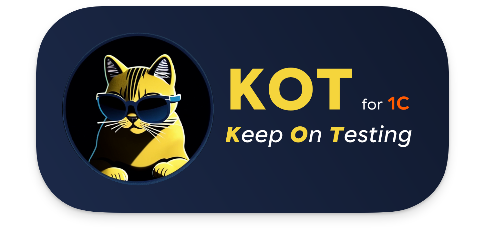
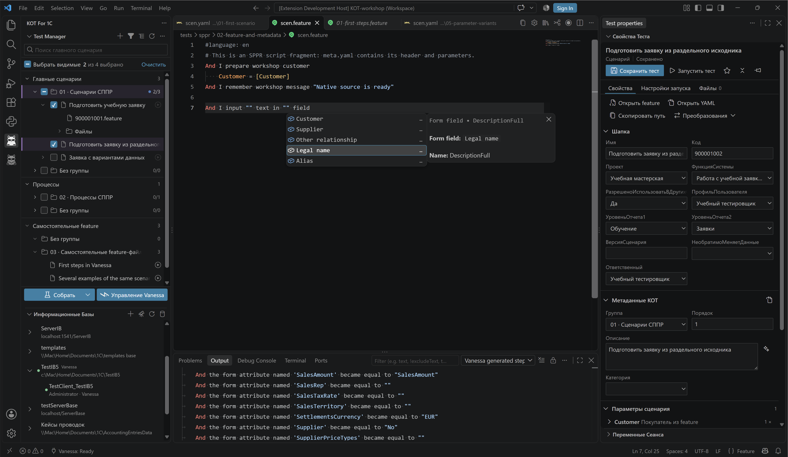
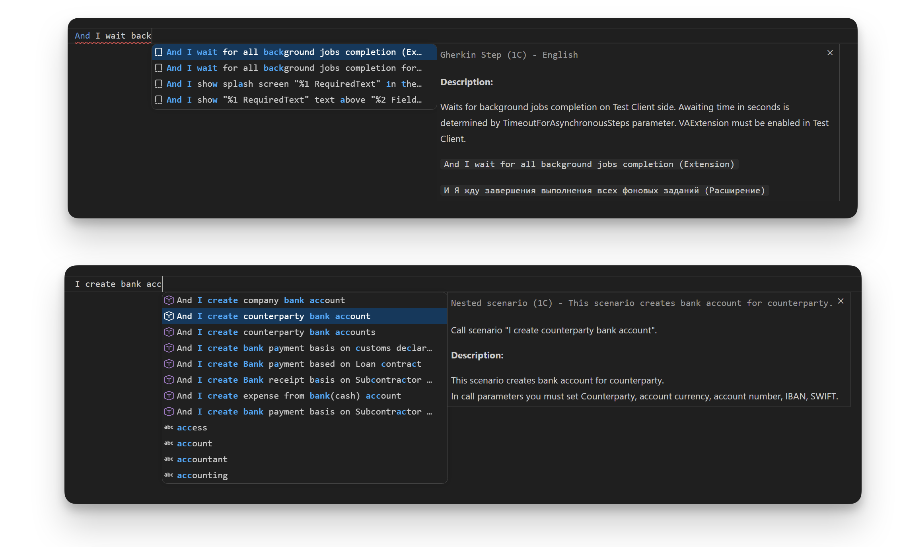
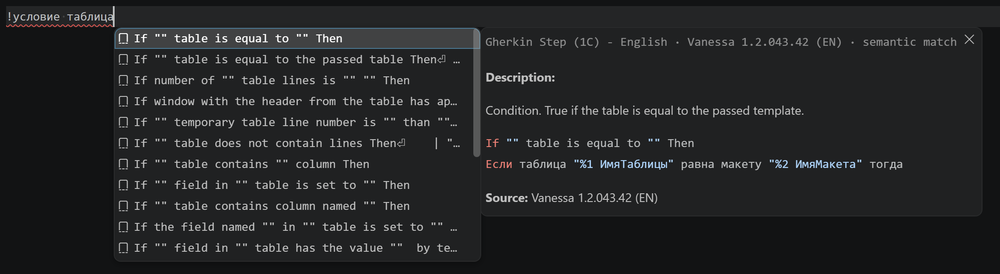
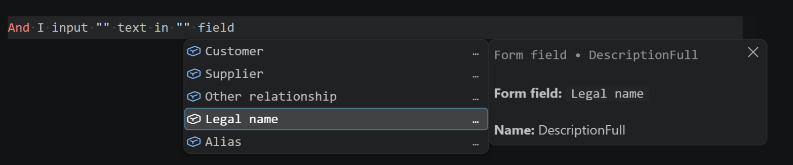
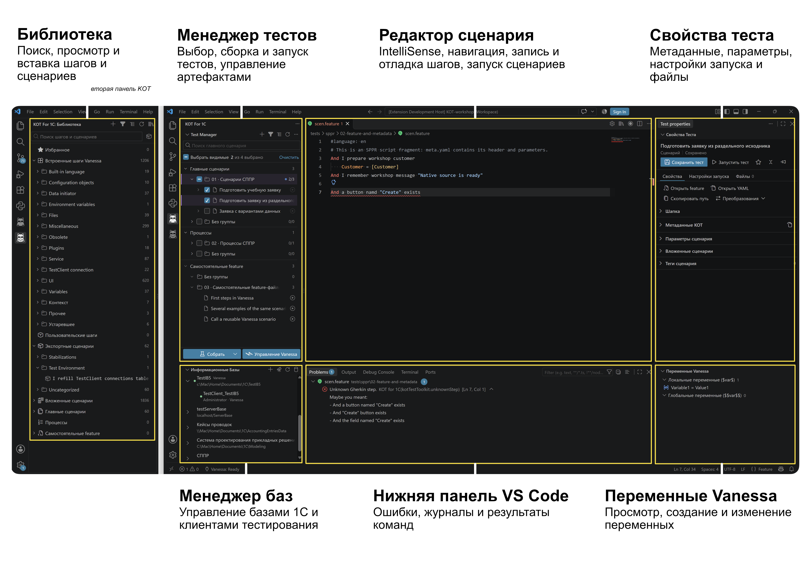

   
  <b>Создавайте, запускайте и сопровождайте тесты 1С в Visual Studio Code.</b>

  
  
  
  
  

****

KOT помогает писать сценарии СППР и Vanessa Automation: подсказывает шаги и параметры, открывает вложенные вызовы, собирает тесты и связывает редактор с работающей Vanessa. Свойства теста, библиотека шагов, информационные базы и результаты доступны в одном рабочем пространстве.

[Начать работу](docs/QUICK_START.md) · [Учебная мастерская](examples/kot-workshop/README.md) · [Все документы](#все-документы) · [Изменения 3.0.0](CHANGELOG.md)

*Редактор сценария СППР с подсказками полей формы, Менеджер тестов, список баз и свойства сценария.*

## Что можно делать

| Задача | Как помогает KOT | Подробнее |
|---|---|---|
| Написать первый тест | Мастер проекта, готовые примеры, создание сценария и выбор формата | [Начало работы](docs/guides/first-run-settings.md) |
| Набрать шаг и его аргументы | IntelliSense шагов, сценариев, параметров и переменных; описание выбранной подсказки | [Автодополнение](docs/guides/editor-and-intellisense.md#работать-в-тексте) |
| Найти нужный шаг | Библиотека Vanessa и проекта, категории, поиск по `!`, предпросмотр, вставка | [Библиотека и редактор](docs/guides/editor-and-intellisense.md) |
| Читать чужие тесты | F12, ссылки на вызовы, описание параметров, подсветка зависимостей | [Навигация](docs/guides/navigation-and-files.md) |
| Редактировать СППР | Один YAML или feature + метаданные YAML; свойства, параметры, вложенные вызовы | [Форматы](docs/guides/scenario-source-formats.md) |
| Переиспользовать проверки | Вложенные сценарии, экспортные сценарии Vanessa, пользовательские BSL-шаги | [Создание и переиспользование](docs/guides/scenario-creation.md) |
| Организовать набор тестов | Главные сценарии, процессы, группы, отметки сборки, избранное и фильтры | [Менеджер тестов](docs/guides/test-manager.md) |
| Собрать и выполнить | Профили компиляции, проверка параметров, отчёт об ошибках, запуск feature | [Компиляция и запуск](docs/guides/build-and-vanessa-run.md) |
| Проверить несколько шагов | F11, выполнение выделения, запуск с шага, точки останова и проба простого YAML до сборки | [Управление Vanessa](docs/guides/vanessa-control.md) |
| Получить шаги из приложения | Запись действий, исследование формы, нативные подсказки и проверки всей формы | [Form Explorer](docs/guides/form-explorer.md) |
| Разобраться с ошибкой | Цвет строк, текст ошибки, переменные, журналы и диагностический пакет | [Диагностика](docs/guides/diagnostics-and-quick-fix.md) |
| Подготовить окружение | Базы, платформы, клиенты тестирования, DT/CF, шаблоны и эталонные состояния | [Информационные базы](docs/guides/infobase-manager.md) |
| Работать в команде | Общие группы, каталоги и серии номеров в Git; личное состояние отдельно | [Общие данные проекта](docs/guides/shared-project-library.md) |
| Использовать ИИ | Описание сценария, отчёт по изменениям конфигурации и ревью изменённых тестов | [AI-инструменты](docs/guides/ai-description.md) |

## Выберите свой маршрут

### У меня уже есть тесты СППР

Откройте папку проекта и запустите **KOT: Настроить проект**. Мастер найдёт сценарии, процессы и настройки запуска. Существующие исходники сохранят свой формат. Для полной компиляции потребуется обработка `СборкаТекстовСценариев`, выгруженная из вашей конфигурации СППР в `.epf`.

→ [Подключить СППР и собрать первый тест](docs/QUICK_START.md#проект-сппр)

### Я пишу обычные feature Vanessa

Используйте самостоятельные `.feature`: компилятор СППР для них не нужен. В свойствах доступны сценарии, теги и JSON запуска; библиотека и подсказки работают непосредственно в тексте feature.

→ [Начать с Vanessa](docs/QUICK_START.md#проект-vanessa)

### Я знакомлюсь с автоматизацией 1С

Откройте копию [учебной мастерской](examples/kot-workshop/README.md). В ней есть небольшие примеры с пояснениями и карта возможностей. Читать и редактировать их можно без установленной 1С; окружение выполнения подключается позже.

→ [Пройти первое упражнение](docs/QUICK_START.md#попробовать-без-1с)

## Редактор и IntelliSense

### Подсказки шагов, параметров и переменных

Начните вводить шаг или нажмите **Ctrl+Space**: KOT предложит подходящие определения и покажет описание выбранного варианта. Подсказки работают в YAML, `feature + meta` и самостоятельных feature с учётом доступных в каждом формате вызовов.

- **Шаги и вызовы:** определения Vanessa, экспортные сценарии и, в СППР, вложенные сценарии проекта.
- **Параметры СППР:** введите `[` для выбора объявленного параметра; в подсказке видно его значение по умолчанию.
- **Переменные Vanessa:** `$` и `$$` вызывают подсказки локальных и глобальных переменных в соответствующем контексте.

### Поиск по смыслу через `!`

Введите `!` и слова о действии, выберите подходящий шаг и заполните его аргументы. Поиск работает локально, без AI-сервиса.

### Аргументы из активной формы 1С

Подключённая форма подсказывает подписи и технические имена элементов, а для подходящих аргументов — таблицы, колонки и текущие значения.

[Подробнее о подсказках и Библиотеке](docs/guides/editor-and-intellisense.md) · [Визуальный маршрут: от настройки до результата](docs/visual-tour.md)

## Как выполняется тест

Исходник СППР проходит компиляцию. Самостоятельная feature Vanessa запускается без этого этапа. Дальше Vanessa управляет клиентом проверяемой базы, а KOT управляет сеансом Vanessa через MCP и показывает полученные результаты.

Посмотрите реальные примеры: 

#### Запись действий в сценарий

https://github.com/user-attachments/assets/61768005-3fce-489f-b8a4-dc3395221d72

#### Точка останова, выполнение шагов и ошибка

https://github.com/user-attachments/assets/eaa3e411-c519-40f0-ac45-1028396db667

#### Отчёт о сборке теста с переходом к ошибке
[Пример отчета](docs/guides/build-and-vanessa-run.md#разобрать-результат-компиляции)

Кадры с результатом и пояснения есть в [руководстве по управлению Vanessa](docs/guides/vanessa-control.md).

## Как устроен интерфейс

**Слева** — выбор и организация тестов, библиотека определений и информационные базы. **В центре** — обычный редактор исходника или полная панель инструмента. **Справа** — свойства открытого теста и переменные сеанса. **В строке состояния** — подключение Vanessa.

Сохранение файла, Undo и привычная навигация VS Code остаются доступны. Настройки KOT открываются отдельной страницей; знакомство с проектом запускается явной кнопкой.

[Визуальный маршрут по возможностям](docs/visual-tour.md) · [Контекстные меню](docs/context-menus.md) · [Реальные экраны](docs/screenshots.md) · [Знакомство с интерфейсом](docs/interface.md)

## Что нужно установить

| Для чего | Необходимое окружение |
|---|---|
| Читать и писать тесты | VS Code **1.106+** и KOT; Windows, macOS или Linux |
| Компилировать СППР | Windows, платформа 1С и совместимая обработка компилятора СППР |
| Выполнять тесты | Windows, платформа 1С, Vanessa Automation и тестовая база |
| Управлять работающей Vanessa | Сеанс с совместимыми MCP-инструментами; KOT умеет подготовить собственный управляемый сеанс |
| Использовать AI | Доступный OpenAI-совместимый сервис; подключается отдельно |

[Установка и подготовка окружения](docs/SETUP.md) · [Совместимость и ограничения](docs/technical/compatibility.md)

Справочники поставщиков: [компилятор СППР на ИТС](https://its.1c.ru/db/sppr2doc#content:124:hdoc), [JSON-параметры Vanessa](https://pr-mex.github.io/vanessa-automation/dev/JsonParams/JsonParamsRU/), [программа работы с файлами 1С для MXL](https://v8.1c.ru/static/1s-predpriyatie-rabota-s-faylami/).

Документация описывает **3.0.0**. Сверяйте её с версией установленного расширения. Локальные операции 1С на macOS/Linux пока не являются поддержанным сценарием KOT.

## Важные различия

- **Компиляция** превращает исходник СППР в feature. **Выполнение** проходит шаги в Vanessa. Успешная компиляция ещё не означает, что тест пройден.
- **Менеджер тестов KOT** — панель VS Code. **Менеджер тестирования** — сеанс 1С с Vanessa, который управляет клиентами проверяемых баз.
- Пара `scen.feature` + `meta.yaml` остаётся исходником СППР. Обычная самостоятельная feature запускается без компиляции СППР.
- Возможности управления зависят от версии и инструментов MCP Vanessa. Простое выполнение YAML до сборки не заменяет проверку всего сценария компилятором.

[Короткий словарь](docs/terminology.md)

## Документация и участие

- [Руководства по задачам](docs/README.md) — от первого сценария до записи действий и сопровождения набора тестов.
- [Технические справочники](docs/technical/README.md) — настройки, команды, форматы, компилятор и MCP.
- [Разработка и проверка](docs/DEVELOPMENT.md) — сборка расширения, тесты и правила проверки изменений.
- [Сообщить об ошибке](https://github.com/alexiosus/KOTfor1C/issues) — укажите версии KOT, VS Code и Vanessa, способ запуска и минимальный пример.

<strong>Полное дерево документации — раскрыть</strong>

Все текущие руководства, уроки и справочники доступны отсюда. Выберите ветку по своей задаче.

- **Начало работы и обзор**
  - [Оглавление руководства](docs/README.md)
  - [Первый тест: быстрый старт](docs/QUICK_START.md)
  - [Подготовка KOT и окружения 1С](docs/SETUP.md)
  - [Где что находится в интерфейсе](docs/interface.md)
  - [Карта возможностей](docs/capabilities.md)
  - [Визуальный маршрут](docs/visual-tour.md)
  - [Скриншоты и схемы](docs/screenshots.md)
  - [План новых кадров: места вставки и действия](docs/screenshot-plan.md)
  - [Полезные повседневные действия](docs/everyday-workflows.md)
  - [Контекстные меню](docs/context-menus.md)
  - [Словарь KOT, СППР и Vanessa](docs/terminology.md)
  - [Решение проблем](docs/troubleshooting.md)
- **Написание и организация тестов**
  - [Оглавление руководств по возможностям](docs/guides/README.md)
  - [Мастер проекта и настройки](docs/guides/first-run-settings.md)
  - [Создание и переиспользование тестов](docs/guides/scenario-creation.md)
  - [Форматы исходников и преобразования](docs/guides/scenario-source-formats.md)
  - [Редактор, Библиотека и поиск шагов](docs/guides/editor-and-intellisense.md)
  - [Свойства теста](docs/guides/scenario-properties-editor.md)
  - [Параметры и переменные](docs/guides/scenario-parameters.md)
  - [Параметры процессов и настроек запуска](docs/guides/compiler-process-parameters.md)
  - [Самостоятельные feature Vanessa](docs/guides/standalone-features.md)
  - [Менеджер тестов](docs/guides/test-manager.md)
  - [Навигация и вложения](docs/guides/navigation-and-files.md)
  - [Общие данные проекта](docs/guides/shared-project-library.md)
  - [Состояния тестов и актуальность сборки](docs/guides/metadata-and-cache.md)
- **Выполнение и окружение 1С**
  - [Компиляция и выполнение теста](docs/guides/build-and-vanessa-run.md)
  - [Параметры сборки и запуска](docs/guides/parameters-manager.md)
  - [Управление Vanessa: F11, запись и переменные](docs/guides/vanessa-control.md)
  - [Form Explorer: от формы к шагам](docs/guides/form-explorer.md)
  - [Информационные базы и клиенты тестирования](docs/guides/infobase-manager.md)
  - [Выбор платформы 1С](docs/guides/platform-manager.md)
  - [Эталонные базы](docs/guides/etalon-bases.md)
  - [Диагностика и исправление ошибок](docs/guides/diagnostics-and-quick-fix.md)
  - [Сохранённый набор клиентов для отдельного запуска](docs/guides/vanessa-debug-clients.md)
- **AI-инструменты**
  - [Описание сценария, анализ изменений и ревью тестов](docs/guides/ai-description.md)
  - [Подключение AI-сервиса: примеры настроек](docs/guides/ai-connections.md)
- **Учебная мастерская**
  - [Открыть мастерскую и выбрать упражнение](examples/kot-workshop/README.md)
  - [1. Осмотритесь в KOT](examples/kot-workshop/guide/01-interface.md)
  - [2. Попробуйте редактор](examples/kot-workshop/guide/02-editor.md)
  - [3. Сценарии и процессы СППР](examples/kot-workshop/guide/03-sppr.md)
  - [4. Запустите шаги в Vanessa](examples/kot-workshop/guide/04-vanessa.md)
  - [5. Базы, клиенты тестирования и исследование формы](examples/kot-workshop/guide/05-infobases.md)
  - [6. Организуйте проект и попробуйте переход со старого KOT](examples/kot-workshop/guide/06-project.md)
  - [7. Отчёты, AI и дополнительные инструменты](examples/kot-workshop/guide/07-extra-tools.md)
  - [Карта возможностей мастерской](examples/kot-workshop/guide/feature-map.md)
  - [Учебные параметры](examples/kot-workshop/config/README.md)
  - [Пример пользовательского шага](examples/kot-workshop/libraries/user-steps/README.md)
- **Технические справочники**
  - [Оглавление технического раздела](docs/technical/README.md)
  - [Все настройки](docs/technical/settings-reference.md)
  - [Команды и сочетания клавиш](docs/technical/commands-reference.md)
  - [Файлы проекта и владельцы данных](docs/technical/project-files.md)
  - [Поля исходника СППР и настройки запуска](docs/technical/sppr-source-fields.md)
  - [Контракт компилятора и запуска](docs/technical/compiler.md)
  - [Выполнение и MCP Vanessa](docs/technical/execution-and-mcp.md)
  - [Каталоги шагов и определений](docs/technical/step-catalogs.md)
  - [AI: контекст запросов и отчёты](docs/technical/ai-data.md)
  - [Архитектура KOT](docs/technical/architecture.md)
  - [Обработка документа и добавление возможностей](docs/technical/contributing-workflows.md)
  - [Подготовленный DT служебной базы](docs/technical/startup-template.md)
  - [Источники данных Form Explorer](docs/technical/form-explorer-bridge.md)
  - [Совместимость и известные ограничения](docs/technical/compatibility.md)
- **Разработка и сведения о проекте**
  - [Структура каталогов репозитория](docs/technical/repository-layout.md)
  - [Все примеры](examples/README.md)
  - [Сборка, тестирование и разработка KOT](docs/DEVELOPMENT.md)
  - [Как вносить изменения](CONTRIBUTING.md)
  - [Политика безопасности](SECURITY.md)
  - [История изменений](CHANGELOG.md)
  - [Лицензия KOT](LICENSE)
  - [Компоненты и сторонние лицензии](THIRD_PARTY_LICENSES.md)

Материалы проектирования и история разработки находятся отдельно в репозитории: [спецификации](https://github.com/alexiosus/KOTfor1C/tree/HEAD/docs/superpowers/specs), [планы](https://github.com/alexiosus/KOTfor1C/tree/HEAD/docs/superpowers/plans), [аудиты](https://github.com/alexiosus/KOTfor1C/tree/HEAD/docs/superpowers/audits), [черновики issue Vanessa](https://github.com/alexiosus/KOTfor1C/tree/HEAD/docs/superpowers/issues), [макет первого запуска](https://github.com/alexiosus/KOTfor1C/tree/HEAD/docs/ux/first-run) и [проверка интерфейса](https://github.com/alexiosus/KOTfor1C/tree/HEAD/docs/qa). Они фиксируют отдельные этапы работы; актуальное поведение описано в руководствах выше.

## Лицензия и благодарности

KOT for 1C распространяется по [MIT](LICENSE). Упоминания 1С, СППР и Vanessa Automation обозначают совместимость; KOT — самостоятельный проект.

Спасибо разработчикам [Vanessa Automation](https://github.com/Pr-Mex/vanessa-automation), [1c-neurofish / onec-client-mcp-devkit](https://github.com/1c-neurofish/onec-client-mcp-devkit) и [WebTransport](https://github.com/alkoleft/web-transport-addin), а также участникам проекта. Версии включённых компонентов, исходники и условия распространения перечислены в [THIRD_PARTY_LICENSES.md](THIRD_PARTY_LICENSES.md).

Отдельная благодарность командам тестирования и DevOps 1C:Drive за практические сценарии, обратную связь и помощь с инфраструктурой, а также сообществу тестирования 1С.
