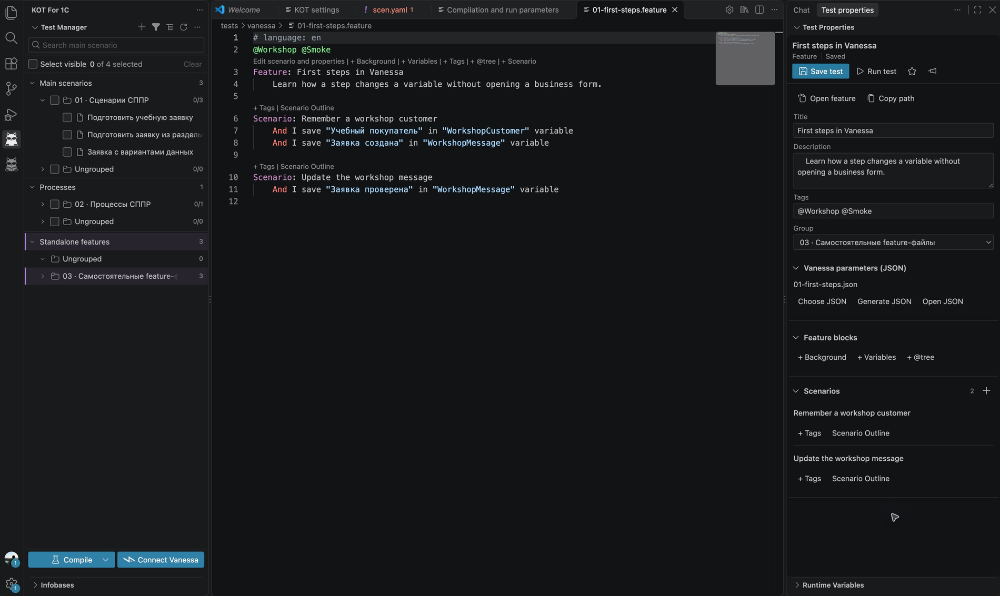
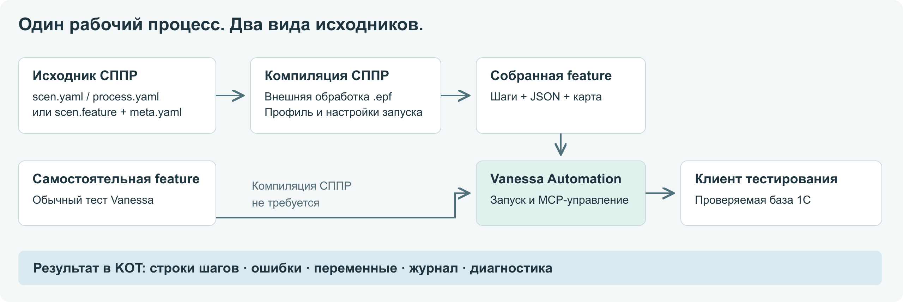

# KOT for 1C

**Создавайте, запускайте и сопровождайте тесты 1С в Visual Studio Code.**

KOT помогает писать сценарии СППР и Vanessa Automation: подсказывает шаги и параметры, открывает вложенные вызовы, собирает тесты и связывает редактор с работающей Vanessa. Свойства теста, библиотека шагов, информационные базы и результаты доступны в одном рабочем пространстве.

[Начать работу](documentation/QUICK_START.md) · [Учебная мастерская](examples/kot-workshop/README.md) · [Все руководства](documentation/README.md) · [Изменения 3.0.0](CHANGELOG.md)

*Реальный интерфейс на учебной feature: текст в центре, набор тестов слева, параметры и действия справа.*

## Что можно делать

| Задача | Как помогает KOT | Подробнее |
|---|---|---|
| Написать первый тест | Мастер проекта, готовые примеры, создание сценария и выбор формата | [Начало работы](documentation/blocks/first-run-settings.md) |
| Найти нужный шаг | Библиотека Vanessa и проекта, категории, поиск, предпросмотр, вставка | [Библиотека и редактор](documentation/blocks/editor-and-intellisense.md) |
| Читать чужие тесты | F12, ссылки на вызовы, описание параметров, подсветка зависимостей | [Навигация](documentation/blocks/navigation-and-files.md) |
| Редактировать СППР | Один YAML или feature + метаданные YAML; свойства, параметры, вложенные вызовы | [Форматы](documentation/blocks/scenario-source-formats.md) |
| Переиспользовать проверки | Вложенные сценарии, экспортные сценарии Vanessa, пользовательские BSL-шаги | [Создание и переиспользование](documentation/blocks/scenario-creation.md) |
| Организовать набор тестов | Главные сценарии, процессы, группы, отметки сборки, избранное и фильтры | [Менеджер тестов](documentation/blocks/test-manager.md) |
| Собрать и выполнить | Профили компиляции, проверка параметров, отчёт об ошибках, запуск feature | [Компиляция и запуск](documentation/blocks/build-and-vanessa-run.md) |
| Проверить несколько шагов | F11, выполнение выделения, запуск с шага, точки останова и проба простого YAML до сборки | [Управление Vanessa](documentation/blocks/vanessa-control.md) |
| Получить шаги из приложения | Запись действий, исследование формы, нативные подсказки и проверки всей формы | [Form Explorer](documentation/blocks/form-explorer.md) |
| Разобраться с ошибкой | Цвет строк, текст ошибки, переменные, журналы и диагностический пакет | [Диагностика](documentation/blocks/diagnostics-and-quick-fix.md) |
| Подготовить окружение | Базы, платформы, клиенты тестирования, DT/CF, шаблоны и эталонные состояния | [Информационные базы](documentation/blocks/infobase-manager.md) |
| Работать в команде | Общие группы, каталоги и серии номеров в Git; личное состояние отдельно | [Общие данные проекта](documentation/blocks/shared-project-library.md) |
| Использовать ИИ | Описание сценария, отчёт по изменениям конфигурации и ревью изменённых тестов | [AI-инструменты](documentation/blocks/ai-description.md) |

## Выберите свой маршрут

### У меня уже есть тесты СППР

Откройте папку проекта и запустите **KOT: Настроить проект**. Мастер найдёт сценарии, процессы и настройки запуска. Существующие исходники сохранят свой формат. Для полной компиляции потребуется обработка `СборкаТекстовСценариев`, выгруженная из вашей конфигурации СППР в `.epf`.

→ [Подключить СППР и собрать первый тест](documentation/QUICK_START.md#проект-сппр)

### Я пишу обычные feature Vanessa

Используйте самостоятельные `.feature`: компилятор СППР для них не нужен. В свойствах доступны сценарии, теги и JSON запуска; библиотека и подсказки работают непосредственно в тексте feature.

→ [Начать с Vanessa](documentation/QUICK_START.md#проект-vanessa)

### Я знакомлюсь с автоматизацией 1С

Откройте копию [учебной мастерской](examples/kot-workshop/README.md). В ней есть небольшие примеры с пояснениями и карта возможностей. Читать и редактировать их можно без установленной 1С; окружение выполнения подключается позже.

→ [Пройти первое упражнение](documentation/QUICK_START.md#попробовать-без-1с)

## Как выполняется тест

Исходник СППР проходит компиляцию. Самостоятельная feature Vanessa запускается без этого этапа. Дальше Vanessa управляет клиентом проверяемой базы, а KOT показывает полученные результаты.

## Как устроен интерфейс

**Слева** — выбор и организация тестов, библиотека определений и информационные базы. **В центре** — обычный редактор исходника или полная панель инструмента. **Справа** — свойства открытого теста и переменные сеанса. **В строке состояния** — подключение Vanessa.

Сохранение файла, Undo и привычная навигация VS Code остаются доступны. Настройки KOT открываются отдельной страницей; знакомство с проектом запускается явной кнопкой.

[Посмотреть реальные экраны](documentation/screenshots.md) · [Знакомство с интерфейсом](documentation/interface.md)

## Что нужно установить

| Для чего | Необходимое окружение |
|---|---|
| Читать и писать тесты | VS Code **1.106+** и KOT; Windows, macOS или Linux |
| Компилировать СППР | Windows, платформа 1С и совместимая обработка компилятора СППР |
| Выполнять тесты | Windows, платформа 1С, Vanessa Automation и тестовая база |
| Управлять работающей Vanessa | Сеанс с совместимыми MCP-инструментами; KOT умеет подготовить собственный управляемый сеанс |
| Использовать AI | Доступный OpenAI-совместимый сервис; подключается отдельно |

[Установка и подготовка окружения](documentation/SETUP.md) · [Совместимость и ограничения](documentation/technical/compatibility.md)

Документация описывает **3.0.0**. Сверяйте её с версией установленного расширения. Локальные операции 1С на macOS/Linux пока не являются поддержанным сценарием KOT.

## Важные различия

- **Компиляция** превращает исходник СППР в feature. **Выполнение** проходит шаги в Vanessa. Успешная компиляция ещё не означает, что тест пройден.
- **Менеджер тестов KOT** — панель VS Code. **Менеджер тестирования** — сеанс 1С с Vanessa, который управляет клиентами проверяемых баз.
- Пара `scen.feature` + `meta.yaml` остаётся исходником СППР. Обычная самостоятельная feature запускается без компиляции СППР.
- Возможности управления зависят от версии и инструментов MCP Vanessa. Простое выполнение YAML до сборки не заменяет проверку всего сценария компилятором.

[Короткий словарь](documentation/terminology.md)

## Документация и участие

- [Руководства по задачам](documentation/README.md) — от первого сценария до записи действий и сопровождения набора тестов.
- [Технические справочники](documentation/technical/README.md) — настройки, команды, форматы, компилятор и MCP.
- [Разработка и проверка](documentation/DEVELOPMENT.md) — сборка расширения, тесты и правила проверки изменений.
- [Сообщить об ошибке](https://github.com/alexiosus/KOTfor1C/issues) — укажите версии KOT, VS Code и Vanessa, способ запуска и минимальный пример.

## Лицензия и благодарности

KOT for 1C распространяется по [MIT](LICENSE). Упоминания 1С, СППР и Vanessa Automation обозначают совместимость; KOT — самостоятельный проект.

Спасибо разработчикам [Vanessa Automation](https://github.com/Pr-Mex/vanessa-automation), [1c-neurofish / onec-client-mcp-devkit](https://github.com/1c-neurofish/onec-client-mcp-devkit) и [WebTransport](https://github.com/alkoleft/web-transport-addin), а также участникам проекта. Версии включённых компонентов, исходники и условия распространения перечислены в [THIRD_PARTY_LICENSES.md](THIRD_PARTY_LICENSES.md).

Отдельная благодарность командам тестирования и DevOps 1C:Drive за практические сценарии, обратную связь и помощь с инфраструктурой, а также сообществу тестирования 1С.
