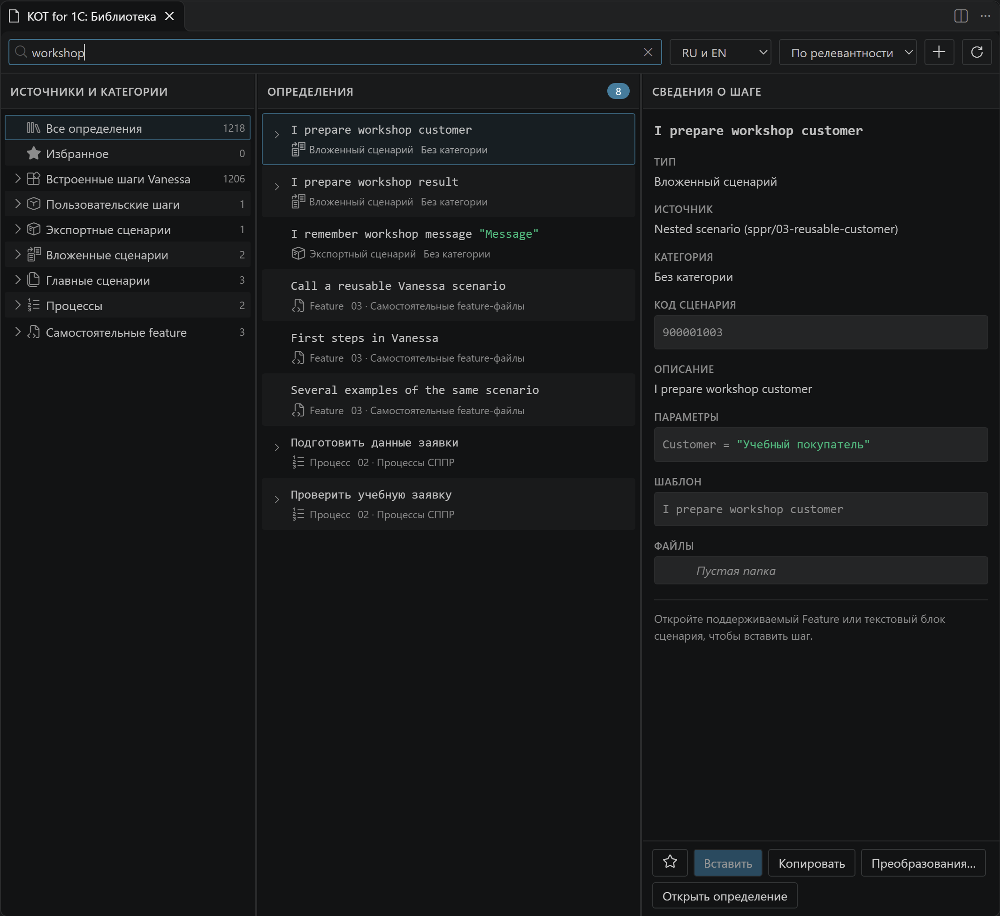

# Редактор и Библиотека

Редактор помогает найти правильный шаг, передать параметры и прочитать вызванный сценарий. Библиотека показывает доступные определения до того, как вы начнёте вводить их имя.

## Найти и вставить шаг

1. Откройте отдельный значок **Библиотеки** слева или полную панель **Открыть библиотеку**.
2. Выберите язык и категорию либо введите часть названия.
3. Посмотрите текст и параметры определения.
4. Поставьте каретку в сценарий и нажмите **Вставить / Insert**.

На кадре поиск `workshop` нашёл учебные определения. У выбранного вложенного сценария справа виден параметр `Customer`; кнопки внизу вставляют вызов, копируют его или открывают исходник. [Карта областей полной Библиотеки](../interface.md#библиотека).

В Библиотеке объединены встроенные шаги выбранной версии Vanessa, экспортные сценарии feature, вложенные сценарии и процессы СППР, а также пользовательские шаги из доступных BSL-исходников. Несобранные пользовательские шаги видны для изучения, но не предлагаются в IntelliSense и недоступны для копирования, вставки и перетаскивания.

### Собрать библиотеку пользовательских шагов

Выберите пользовательский шаг в полной Библиотеке: в его подробностях есть блок **Библиотека EPF** со статусом и кнопками **Создать EPF-библиотеку…**, **Собрать EPF** или **Выгрузить исходники…**. Действие относится к библиотеке выбранного шага — повторно выбирать её не нужно. В полной и панельной Библиотеке эти команды также доступны через **«…»** в строке шага и в контекстном меню. В самой строке остаются вставка, копирование, избранное и **«…»**; открытие исходника находится в меню. Общая кнопка **Библиотеки EPF** позволяет выбрать готовый проект или одиночный BSL без выбора шага, а также выгрузить библиотеку, для которой исходников ещё нет.

Собирается вся обработка библиотеки. Если имеется только отдельный BSL, действие **Создать EPF-библиотеку…** создаёт проект обработки из шаблона Vanessa, копирует реализацию в модуль и запускает сборку. Исходный BSL сохраняется, но его шаги не дублируются в Библиотеке: KOT использует модуль созданной обработки. Дальнейшие изменения вносите в открытый модуль. При удалении созданного проекта исходный BSL снова появляется в Библиотеке как **Только исходник**.

| Состояние | Что делать |
|---|---|
| Только исходник | Создать EPF-библиотеку из BSL |
| Не собрана | Собрать EPF |
| Нужна пересборка | Пересобрать после изменения исходников или замены EPF |
| Собрана | Копировать или вставлять шаги в тест |

После изменения исходников шаги недоступны до успешной пересборки. KOT сравнивает содержимое файлов с последней сборкой; старая EPF без этих сведений также требует сборки. Перед сборкой изменённые открытые файлы обработки сохраняются. При выгрузке выбирается новый каталог: существующие исходники не заменяются.

Для обеих операций нужна платформа 1С; для создания обработки из одиночного BSL также нужна поставка Vanessa с `lib/TemplateEpfUF`. После сборки обновите библиотеку шагов работающей Vanessa. Состояние **Собрана** подтверждает соответствие исходников и EPF, а подключение библиотеки в текущем менеджере задаётся отдельно.

Если drag-and-drop не доходит из панели в редактор, используйте **Вставить**. Это известная граница некоторых версий VS Code, а не признак отсутствия определения.

## Работать в тексте

| Действие | Результат |
|---|---|
| Ввести `!` и слова о действии | Локальный семантический поиск по тексту и описанию шагов; не нужен AI-сервис |
| Начать ввод шага | Контекстное автодополнение; `Ctrl+Space` вызывает его вручную |
| Ввести `[` в сценарии СППР | Список объявленных параметров |
| Навести на `[Customer]` | Значение по умолчанию и доступные действия |
| Нажать F12 на вызове | Открытие определения |
| Найти ссылки / вызовы | Места использования сценария |
| Ввести `$` или `$$` | Подсказки переменных в соответствующем контексте |

На примерах видны разные источники подсказок: определения шагов и сценариев, параметры в квадратных скобках, переменные, имена и значения элементов формы. Данные формы доступны при подключённом клиенте; остальные источники зависят от открытого сценария и каталогов проекта.

## Поиск по смыслу через `!`

Введите `!click button` на новой строке либо `And !click button` после ключевого слова. KOT предлагает определения по словам запроса и их описаниям. Выберите подходящий вариант: запрос заменится настоящим вызовом, а `!` исчезнет. Точное начало имени помнить не нужно.

Поиск работает локально по доступному каталогу и языку сценария. Это не генерация нового шага через LLM. В СППР доступны также вложенные сценарии; самостоятельная feature использует свой допустимый набор определений.

## Подсказки аргументов формы

В аргументах шага KOT не предлагает список всех тегов или случайные шаги. При подключённом клиенте данные активной формы могут давать подсказки имён, таблиц, колонок и значений. Источник формы общий с [Form Explorer](form-explorer.md); отдельная настройка управляет использованием этих данных при закрытой панели.

Каталог встроенных шагов зависит от версии Vanessa, определяемой по её поставке. При отсутствии точного каталога KOT использует доступный резервный источник и не обещает наличие шага в произвольной EPF.

Выделенное имя аргумента из вставленного шаблона заменяется выбранным элементом формы. `Ctrl+Space` позволяет вызвать список вручную. Если список пуст, проверьте подключённый клиент, текущую форму и место каретки: для чисел ожидания или произвольного значения элементы не предлагаются.

## Контекстные действия

Правый клик в тексте → **KOT**: переходы, создание, редактирование, выполнение, запись, проверки формы и привязка журнала. Отдельные меню есть у строк Менеджера тестов и объектов Библиотеки. [Карта контекстных меню](../context-menus.md) объясняет различия и причины недоступных действий.

## Свойства и служебные секции

В паре СППР `scen.feature` редактирует шаги, `meta.yaml` хранит параметры и связи. Подсказки используют оба документа. Синхронизация параметров и вложенных вызовов по тексту доступна настройками и командами KOT.

Подсветка Gherkin-таблиц одинакова в YAML, обычных feature и `feature + meta`. Параметры `[Имя]` выделены жёлтым, переменные Vanessa `$Имя$` и `$$Имя$$` — зелёным, в том числе внутри строк и ячеек таблицы.

Gherkin-таблицы можно выравнивать при сохранении. Пока строка не дописана или число ячеек в строках различается, KOT оставляет таблицу без изменений: удалённые ячейки не восстанавливаются.

Чтобы удалить столбец во всей таблице, выделите его ячейку в первой строке вместе с одним разделителем `|` и удалите. Например, в `| Имя | Значение |` удалите ` Значение |`: ячейки этого столбца удалятся и в строках данных. Если стереть только название, столбец останется. Автоматическое удаление работает в сформированной таблице с двумя и более столбцами; в YAML — внутри `ТекстСценария`, в feature — в тексте сценария. Отменить удаление можно обычным Undo.

Кнопки действий над строками включаются отдельно для YAML и feature; свойства справа доступны независимо от них. Ошибки и исправления объяснены в [руководстве по диагностике](diagnostics-and-quick-fix.md).

[Параметры](scenario-parameters.md) · [Создание библиотек](scenario-creation.md) · [Версионные каталоги: технические детали](../technical/step-catalogs.md)
