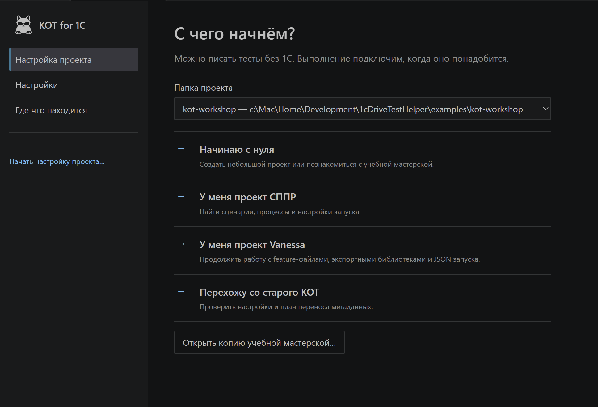

# Мастер проекта и настройки

Откройте **Настройки расширения** в меню KOT. Появится страница параметров; мастер не запускается автоматически. Кнопка **Начать настройку проекта** открывает знакомство, а **Открыть настройки VS Code** — обычный редактор тех же настроек.

## Подготовить проект

| Маршрут | Когда выбрать |
|---|---|
| Начинаю с нуля | Создать небольшой пример СППР или Vanessa |
| У меня проект СППР | Найти существующие сценарии, процессы и настройки запуска |
| У меня проект Vanessa | Подключить обычные feature и экспортные библиотеки |
| Перехожу со старого KOT | Проверить прежние настройки и план переноса метаданных |

1. Выберите папку проекта и запустите поиск. На этом шаге файлы не изменяются.
2. Проверьте предложенные исходники и библиотеки. У путей есть **Обзор…**, библиотеки можно добавлять несколькими папками.
3. Выберите язык и формат **новых** сценариев. Существующие файлы сохранят формат.
4. Создайте отдельный профиль или используйте существующий без перезаписи его параметров.

Список профилей относится к открытому проекту. Для переноса настроек из прежней версии откройте менеджер параметров → меню профилей → **Импортировать прежний общий профиль**, затем вернитесь к мастеру. Оригинал сохраняется, а скопированный профиль можно менять независимо. Учебная мастерская получает свой начальный профиль автоматически.
5. Выберите подготовку выполнения либо **Пока только редактор**.
6. Просмотрите итоговый план и примените его.

Компилятор СППР нужно сохранить из Конфигуратора в отдельный `.epf` внутри проекта. Подробнее — [подготовка окружения](../SETUP.md).

Мастер сохраняет прогресс по папкам. Его можно отложить: обычные действия с тестами и группами остаются доступны. Если подготовка Vanessa отменена, редактор готов, а подключение можно повторить отдельно. Для вторичной папки multi-root мастер профиля предлагает новое окно.

<!-- screenshot-slot: setup-plan -->

## Изменить настройки

Восемь разделов сгруппированы по задачам. Поиск принимает обычные слова и техническое имя ключа. Слева остаётся навигация, прокручивается правая форма.

- **Этот компьютер / User** — личные настройки.
- **Рабочая область / Workspace** — параметры всего окна.
- **Выбранная папка / Folder** — параметры конкретного проекта, когда настройка поддерживает эту область.

В обычном окне одной папки проектные значения записываются в её настройки. В multi-root некоторые параметры действуют на всё окно; страница объясняет, когда нужно выбрать Workspace.

Правки остаются черновиком до **Применить**. Переход между разделами его сохраняет. **Сбросить в выбранной области** удаляет только это переопределение и показывает наследуемое значение. Источник и сброс доступны при наведении и с клавиатуры; значок **i** открывает подробности.

При внешнем изменении KOT покажет конфликт. После частичной ошибки успешно записанные значения повторно не отправляются. При закрытии страницы можно применить или отменить изменения либо оставить черновик в текущем сеансе; после перезагрузки несохранённый черновик настроек не восстанавливается.

<!-- screenshot-slot: setting-details -->

[Все ключи и значения по умолчанию](../technical/settings-reference.md) · [Быстрый старт](../QUICK_START.md)

## Обновление расширения и старый CI

Одна версия KOT может работать с Core и отстающими регионами. Для существующей ветки оставьте выключенным флажок **«Перевести эту ветку на формат KOT 3 — CI подготовлен»**, пока её CI использует прежнюю схему. Пути, профиль и запуск можно настроить без перехода. Исходный YAML и встроенные метаданные останутся на месте.

Когда CI готов, включите флажок и примените проверенный план. Добавьте в Git `.kot/project.yml` вместе с новыми метаданными и изменениями CI. При возврате на старую ветку без этой метки KOT автоматически использует совместимый режим и пересканирует тесты и Библиотеку. Даже пользовательская настройка автоматической конвертации не переводит такую ветку.
