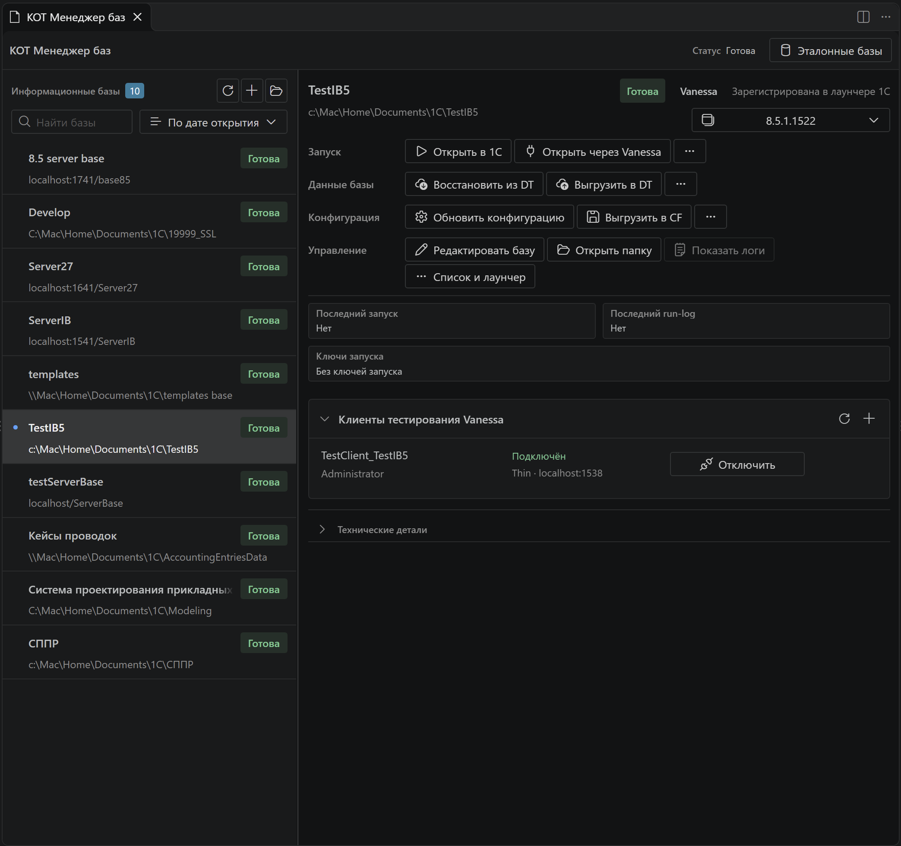
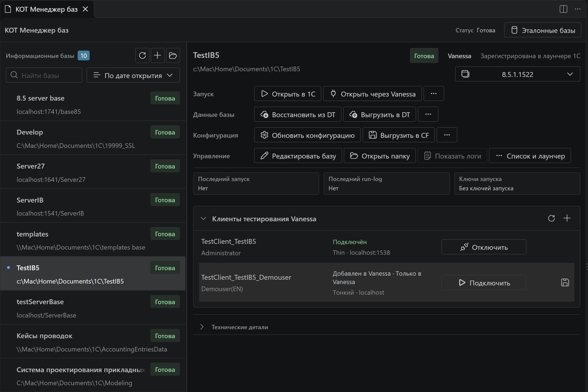

# Информационные базы и клиенты тестирования

Используйте боковую секцию **Информационные базы / Infobases** для повседневных действий, а полный менеджер — для подробностей и обслуживания. Список объединяет известные KOT базы и записи лаунчера 1С.

На кадре TestIB5 доступна, а TestClient_TestIB5 подключён к Vanessa. Действия базы и кнопка отключения клиента относятся к разным объектам.

## Открыть базу

Выберите платформу и способ запуска:

| Действие | Назначение |
|---|---|
| Open in 1C | Обычный запуск предприятия |
| Конфигуратор | Работа с конфигурацией и обслуживанием |
| Open with Vanessa | Запуск как клиента тестирования выбранного профиля |
| Open with Form Explorer | Исследование формы выбранного клиента |

Индикаторы показывают подтверждённое состояние запуска. Роль «использовалась Vanessa» и живое подключение клиента — разные сведения. При нескольких профилях одной базы KOT предлагает выбрать нужную строку.

## Сохранённые и живые клиенты

Раскройте базу в боковой панели либо секцию **Клиенты тестирования Vanessa** в полном менеджере. Каждая строка — самостоятельный профиль с именем клиента, пользователем, типом подключения и дополнительными параметрами. Одна база может иметь несколько клиентов даже для одинакового пользователя, если их имена различаются.

- **Add to Vanessa** — добавить отсутствующий профиль в текущий менеджер.
- **Connect** — добавить при необходимости и подключить клиента.
- **Disconnect** — отключить подтверждённый клиент; это не обязательно закрывает приложение.
- **Save to KOT** — сохранить живую строку Vanessa, которой ещё нет в локальном каталоге.
- Редактирование и удаление доступны в действиях строки.

Изменённая локальная запись может показывать **Changes not applied**: сохранение в KOT не означает применение в уже работающей Vanessa. Для отключённого профиля доступно применение и подключение; подключённый сначала отключите. Конфликт имени с другой базой требует явного решения.

Отсутствующие сохранённые профили могут добавляться автоматически, если включена соответствующая настройка. Это не подключает клиентов и не перезаписывает конфликтующие строки. В `.45` сохранённый порт не считается применённым только по результату profiles API.

Пароль и ключи запуска редактируются для выбранной строки. KOT хранит чувствительные поля локально через SecretStorage; передача их Vanessa необходима для запуска клиента. Не размещайте реальные пароли в демонстрационных файлах или общих каталогах.

У каждого пользователя своя строка и своя кнопка подключения. Значок дискеты появляется в действиях строки **Только в Vanessa** при наведении: он сохраняет этот профиль в KOT. Состояние **Подключён** относится к клиенту, а **Готова** — к записи информационной базы.

## Обслуживание базы

Из меню доступны создание, копирование, восстановление и выгрузка DT, обновление/выгрузка конфигурации CF, установленные шаблоны, регистрация в лаунчере, папка и журналы. Для файловых баз доступны операции с каталогом; серверные и веб-записи имеют иной набор действий.

Перед восстановлением или удалением проверьте выбранную базу и источник. KOT запрашивает подтверждение разрушительных операций; не используйте рабочую базу как учебный стенд.

| Операция | Что меняется |
|---|---|
| Создать / копировать файловую ИБ | Новый каталог базы; после успеха возможна регистрация в списке запуска 1С |
| Пересоздать / Recreate | Содержимое существующей файловой базы; перед операцией можно сохранить DT |
| Восстановить DT | Данные и конфигурация выбранной базы заменяются выгрузкой |
| Выгрузить DT | Создаётся файл резервной выгрузки |
| Обновить конфигурацию | Конфигурация выбранной базы обновляется из файловой выгрузки, CF или установленного шаблона |
| Сохранить CF | Выгружается конфигурация, без полного содержимого базы |
| Перенести / переименовать каталог | Физически перемещаются файлы файловой базы; обновляются известные ссылки |
| Указать другой существующий каталог | Меняется путь записи KOT без переноса файлов |
| Убрать из лаунчера / забыть ручной путь | Удаляется соответствующая запись списка, а не каталог базы |
| Полностью удалить файловую базу | Удаляются файлы и связанные записи; требуется отдельное подтверждение |

Файловые операции с каталогом, копированием и пересозданием относятся к файловым ИБ. Для серверных и web-подключений состав меню иной: доступная запись подключения не означает доступ к их файлам. При занятости базы операция подготовки может быть заблокирована; изучите сообщение и журнал.

## Убрать лишние базы и настроить порядок

В полном менеджере откройте **List and launcher / Список и лаунчер** → **Hide infobase / Скрыть базу**. Вернуть запись можно, включив **Show hidden / Показывать скрытые** в меню сортировки и выбрав **Unhide infobase**. Скрытие не удаляет базу. Скрытые записи исключаются и из обычного выбора базы для Vanessa/Form Explorer; служебные runtime-базы скрываются по умолчанию.

В меню сортировки доступны **Last opened** (последний запуск из KOT), **Alphabetical** и **Manual order**. В ручном режиме перетащите запись на нужное место. Порядок и скрытие относятся к личному состоянию рабочей области и переживают переоткрытие панели.

## Ключи и платформа самой базы

Через **Edit base → Edit launch keys** выберите собственные ключи либо **Use workspace defaults** для использования `kotTestToolkit.startupParams.parameters`. По умолчанию у отдельной базы дополнительных ключей нет. Ключи базы и ключи строки клиента Vanessa — разные настройки; изменяйте профиль клиента, если хотите поменять именно его запуск.

Если при обычном запуске учётные данные неизвестны, KOT не должен подавлять диалог входа. Не добавляйте `/DisableStartupDialogs` автоматически в любую базу. У выбранной базы можно сохранить предпочтительную платформу; она имеет приоритет над общей платформой по умолчанию.

## Почему запись попала в список

Раздел **Technical details** различает **Sources** (откуда KOT узнал о базе) и **Roles** (в каких задачах она используется). Например, источник `launcher` означает запись в `ibases.v8i`, `manual` — добавленный путь, `snapshot` — сведения снимка, `runtime` — служебный каталог, `workspaceState` — сохранённое состояние рабочей области.

Роли `startup`, `vanessa`, `formExplorer`, `snapshot` вычисляются автоматически и могут сочетаться. Историческая роль Vanessa не доказывает, что клиент сейчас подключён: подтверждённое соединение показывается отдельно у клиента.

[Платформы](platform-manager.md) · [Эталонные состояния](etalon-bases.md) · [Управление Vanessa](vanessa-control.md)
