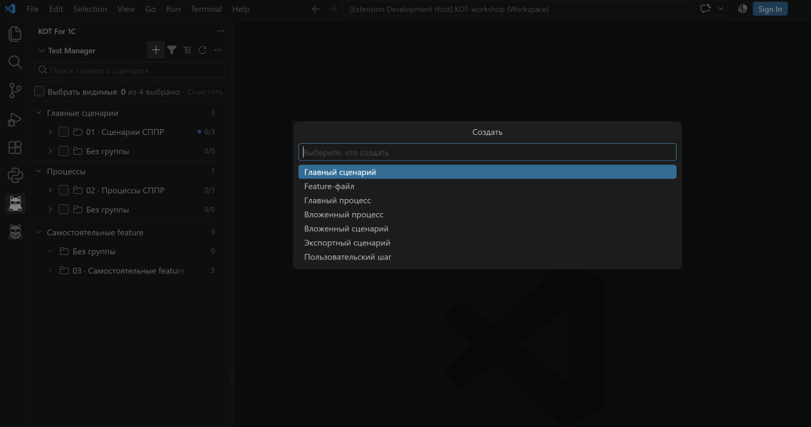

# Создание и переиспользование тестов

Используйте **Создать…** в KOT или **+** нужной секции. Мастер заполняет UID и структуру файлов; вам остаётся выбрать назначение и понятное имя.

## Выбрать тип

| Тип | Когда нужен |
|---|---|
| Главный сценарий СППР | Самостоятельный тест с настройкой запуска |
| Вложенный сценарий СППР | Повторно используемая часть других сценариев |
| Главный процесс СППР | Самостоятельный набор шагов сценариев и подпроцессов |
| Вложенный процесс СППР | Часть другого процесса без отдельного запуска |
| Самостоятельная feature | Обычный тест Vanessa без компиляции СППР |
| Экспортный сценарий | Повторно используемый сценарий в библиотеке feature Vanessa |
| Пользовательский шаг | Новая реализация шага в BSL-библиотеке |

Главный и вложенный СППР-объекты различаются наличием настроек запуска. Добавленная настройка помещается в `test/` соответствующего объекта. Вложенные объекты доступны в Библиотеке и через вызовы.

## Создать сценарий СППР

1. Выберите главный или вложенный сценарий.
2. Укажите имя, код и необходимые поля. Короткий режим использует значения по умолчанию; полный показывает больше свойств.
3. Выберите формат нового исходника: один YAML либо feature + meta.
4. Для главного сценария проверьте создаваемую настройку запуска и при необходимости базу/пользователя.
5. После создания откройте свойства и напишите шаги.

Новый код может выдаваться из авторской серии: шестизначный префикс и трёхзначная последовательность с учётом занятых номеров. Ответственный сценария и автор серии — разные поля. Ручной код также поддерживается.

Функция системы выбирается вместе со своим UID. Ограничение вызова из другой функции задаётся полем `РазрешеноИспользоватьВДругихФункциях`; это правило компилятора, а не группа интерфейса KOT. Назначение остальных полей и связь с настройкой запуска описаны в [справочнике исходника СППР](../technical/sppr-source-fields.md).

Это первый шаг мастера — выбор типа. Главный процесс и вложенный процесс создаются отдельными пунктами; имя, формат исходника и остальные свойства заполняются дальше.

## Изменить связанный сценарий настройки запуска

Откройте YAML из `test/` и найдите карандаш у `Код`, `UIDСценария`, `Имя` или `СценарийНаименование`. Кнопки редактора должны быть включены; их настройка называется **Показывать кнопки действий KOT в редакторе**.

В меню **Change linked scenario / Изменить связанный сценарий** доступны:

- **Rename linked scenario** — перейти к переименованию связанного исходника;
- **Sync from linked scenario** — согласовать ссылочные поля с соседним сценарием;
- **Link to another scenario** — выбрать другой сценарий и обновить `Код`, `UIDСценария`, `Имя`, `СценарийНаименование` настройки.

Последнее действие меняет ссылку настройки, а не переносит текст шагов. UID настройки и UID сценария — разные значения. Для настройки процесса используется соответствующая связь с процессом. После правки просмотрите файл и результат следующей компиляции. Из шапки главного сценария действие **Open test settings** открывает его настройку запуска.

## Собрать процесс

Создайте главный или вложенный процесс, затем добавьте шаги из существующих сценариев и подпроцессов. В свойствах можно менять порядок, удалять шаги и задавать параметры. Подробнее — [параметры процессов](compiler-process-parameters.md).

## Создать библиотеку

Экспортный сценарий записывается в feature-библиотеку. Его имя содержит аргументы, которые будут видны при вставке вызова. Переименование штатной командой обновляет поддерживаемые ссылки.

Для пользовательского BSL-шага KOT помогает создать исходник и библиотеку. Действие **Собрать EPF** в Библиотеке использует Конфигуратор; **Выгрузить исходники…** выполняет обратную операцию. Несобранные и изменённые после сборки шаги доступны для просмотра, но не для вставки и IntelliSense. Подробнее — в [руководстве по Библиотеке](editor-and-intellisense.md#собрать-библиотеку-пользовательских-шагов). Подключение готовой EPF в работающей Vanessa настраивается отдельно.

Изменить тип существующего сценария можно через [Преобразования](scenario-source-formats.md). Инструкции для общих каталогов и нумерации — в [общих данных проекта](shared-project-library.md).
