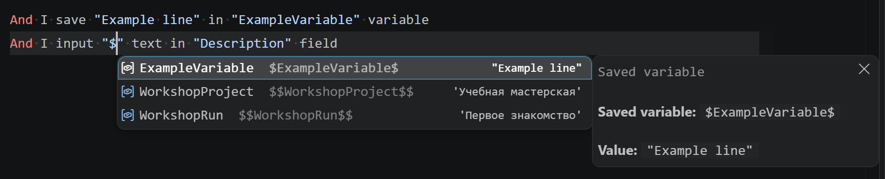

<a id="параметры-сценариев"></a>

# Параметры и переменные

**Параметр СППР** подставляется при компиляции. **Переменная Vanessa** получает значение во время выполнения. Они обозначаются по-разному и редактируются в разных местах.

| Запись | Назначение | Где задаётся |
|---|---|---|
| `[Customer]` | Параметр сценария СППР | Свойства / `ПараметрыСценария` |
| `$Customer$` | Переменная текущего контекста Vanessa | Шаги сценария / панель переменных |
| `$$Customer$$` | Сохранённый контекст Vanessa | Шаги / GlobalVars профиля, в зависимости от сценария |


В парном формате объявление хранится в `meta.yaml`, а подстановка `[Customer]` — в тексте `scen.feature`. Панель свойств редактирует тот же параметр.

<a id="1-как-объявить-параметр"></a>
<a id="2-блок-параметрысценария-и-дефолты"></a>

## Значение по умолчанию

В тексте сценария объявите новый параметр с помощью квадратных скобок: например, [Customer].
Откройте свойства СППР-сценария, найдите параметр **Customer**, задайте тип и значение по умолчанию. Используйте его в тексте:

```gherkin
And I save "[Customer]" in "CurrentCustomer" variable
```

При вводе `[` KOT подскажет объявленные параметры. Hover покажет значение по умолчанию. Для сложного или многострочного значения редактирование может вести к исходному YAML.

<a id="3-передача-параметров-во-вложенный-сценарий"></a>
<a id="5-quick-fix-и-диагностика"></a>

## Передать значение во вложенный вызов

```gherkin
And I prepare workshop customer
    Customer = "Учебный покупатель"
```

Чтобы передать параметр текущего сценария:

```gherkin
And I prepare workshop customer
    Customer = [Customer]
```

Имена должны совпадать с объявлением вызываемого сценария. Если параметр не передан, применяется его значение по умолчанию по правилам компилятора. Quick Fix может дополнить недостающие присваивания.

KOT поддерживает также таблицы, варианты значений и исходящие параметры, но эти конструкции зависят от контракта компилятора СППР. Не заменяйте их обычными runtime-переменными без проверки смысла.

<a id="4-сквозная-передача-через-несколько-уровней"></a>

## Передать значение через несколько сценариев

Каждый фрагмент ниже относится к своему исходнику. Сценарий верхнего уровня передаёт `Customer` во вложенный, а тот — в следующий:

```gherkin
# Главный сценарий
And Prepare order
    Customer = "Учебный покупатель"
```

```gherkin
# Prepare order: объявлен параметр Customer
And Fill order header
    Buyer = [Customer]
```

```gherkin
# Fill order header: объявлен параметр Buyer
And I input "[Buyer]" text in the field named "Customer"
```

На каждом уровне имя слева соответствует параметру вызываемого сценария, а имя в скобках — параметру текущего. В присваивании ссылка передаётся **без внешних кавычек**: `Buyer = [Customer]`. Запись `Buyer = "[Customer]"` передаёт буквальную строку `[Customer]`, поэтому во вложенных шагах вместо покупателя останутся скобки. Для конкретного строкового значения используйте кавычки: `Buyer = "Учебный покупатель"`. Если значение не передано, используется default вызываемого сценария; совпадение имён само по себе не передаёт значение между уровнями.

<a id="7-важные-правила"></a>

## Обычные квадратные скобки

Чтобы текст не стал параметром СППР, экранируйте обе скобки в тексте сценария: `\[Customer\]`. В YAML-блоке `ТекстСценария: |` обратные косые черты записываются буквально. В двойной кавычечной YAML-строке действуют ещё и правила YAML-экранирования; для многострочного сценария удобнее блок `|`.

<a id="6-переменные--и-"></a>

## Подсказки переменных



Ввод `$` предлагает переменные, найденные в предыдущих поддерживаемых RU/EN шагах сохранения, а также доступные GlobalVars профиля. Ввод `$$` ограничивает список глобальными переменными: из предыдущих глобальных шагов сохранения и из GlobalVars. Это поиск объявлений в исходнике и профиле; фактические значения работающего сеанса смотрите в панели переменных.

## Настройка запуска и процесс

Настройка запуска может переопределить значения конкретного теста, не меняя defaults общего сценария. Процесс передаёт общие значения и значения отдельного шага. Порядок и примеры описаны в [параметрах процессов](compiler-process-parameters.md) и [справочнике компилятора](../technical/compiler.md).

## Посмотреть фактическое значение

После подключения Vanessa раскройте **Переменные Vanessa** справа. Локальные (`$Имя$`) и глобальные (`$$Имя$$`) значения читаются из подключённого сеанса; карандаш меняет строковое значение. Проверенный MCP API не даёт полной информации о типах и корректного удаления глобальных переменных.

[Учебный пример с параметрами](../../examples/kot-workshop/tests/sppr/05-parameter-variants/scen.yaml) · [Управление Vanessa](vanessa-control.md)
