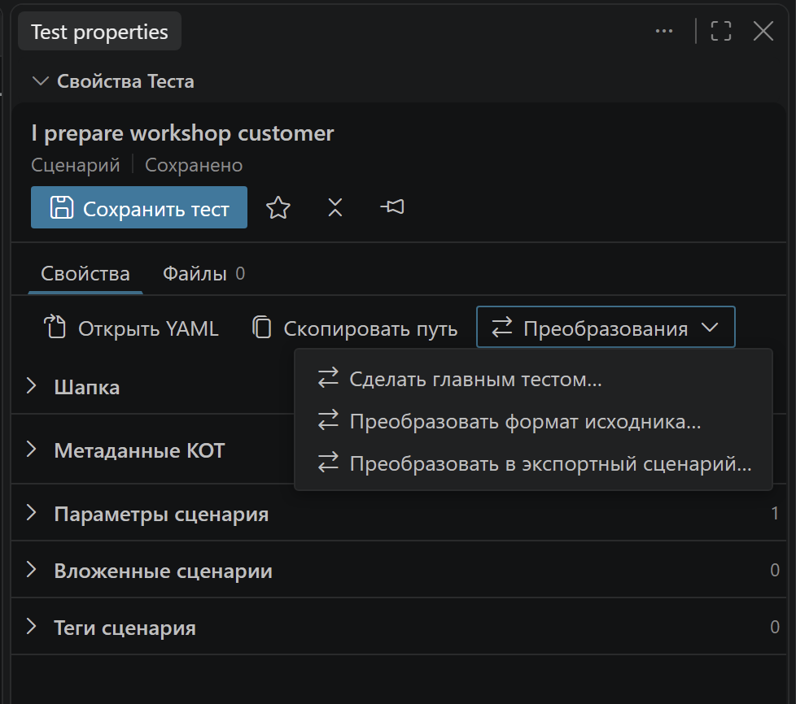

# Форматы исходников и преобразования

KOT поддерживает оба представления сценария СППР. Выбор влияет на расположение текста, но не превращает СППР-сценарий в самостоятельную feature Vanessa.

## Два формата СППР

| Один YAML | Feature + метаданные YAML |
|---|---|
| `scen.yaml` содержит шапку, параметры, связи и `ТекстСценария` | `meta.yaml` содержит шапку, параметры и связи; `scen.feature` — текст шагов |
| Удобен в проектах с существующим единым форматом | Удобен для работы с текстом в отдельном редакторе |
| Сохраняется один документ | **Сохранить тест** сохраняет оба документа |

В парном `scen.feature` работают параметры `[Имя]`, вложенные и экспортные вызовы, подсказки, ховеры и диагностика СППР. **Open feature** ведёт к шагам, **Open YAML** — к метаданным.

Для новых сценариев по умолчанию выбран **feature + meta**. При сохранении старого `scen.yaml` KOT автоматически преобразует его в этот формат. Обе настройки можно изменить: формат новых сценариев и преобразование существующих при сохранении задаются отдельно. Конфликты целевых файлов и несохранённые соседние документы останавливают преобразование.

<!-- screenshot-slot: conversion-result -->

## Где находится конвертер

Откройте **Преобразования** в свойствах теста, Библиотеке или контекстном меню KOT. Доступные действия зависят от выбранного определения.

| Преобразование | Результат |
|---|---|
| YAML ↔ feature + meta | Меняется представление исходника; UID, настройки и вложения сохраняются |
| Главный ↔ вложенный сценарий/процесс | Создаётся либо архивируется настройка запуска; отдельную папку назначения выбирать не нужно |
| Вложенный ↔ экспортный сценарий | Меняется способ переиспользования и представление параметров; проверяются вызовы |

Перед преобразованием сохраните изменённые документы. KOT остановит операцию при конфликте целевых файлов, неоднозначном определении или конструкции без безопасного эквивалента.

## Массовый переход на feature + meta

В меню **… → Обслуживание** Менеджера тестов выберите **Преобразовать YAML-сценарии в feature + meta…**. В списке будут главные и вложенные сценарии `scen.yaml` из каталога проекта. Все отмечены по умолчанию; снимите отметки с тех, которые хотите оставить в YAML, и подтвердите выбор.

Каждый выбранный `scen.yaml` заменяется парой `scen.feature` + `meta.yaml` в той же папке. UID, параметры, связи, настройки запуска и вложения сохраняются. Процессы и самостоятельные feature в это преобразование не входят.

Во время работы показывается прогресс. Отмена оставляет уже преобразованные сценарии и останавливает переход перед следующим файлом. Несохранённые документы и конфликты целевых файлов пропускаются с указанием причины; остальные сценарии продолжают обрабатываться. После завершения открывается один отчёт со ссылками на результат, обновляются Библиотека и состояния собранных тестов. Исправив причины пропусков, можно запустить команду повторно: преобразованные сценарии уже не попадут в список.

<!-- screenshot-slot: batch-conversion -->

## Вложенный ↔ экспортный

При создании экспорта выберите новый файл или существующую feature из списка библиотек. Язык должен совпадать, имя не должно дублировать существующий сценарий. Заголовок предзаполняется параметрами; потерянные, повторяющиеся и лишние аргументы не допускаются.

KOT обновляет поддерживаемые вызовы с сохранением переданных значений и ссылок на параметры родителя. Собранные feature не исправляются вручную: они помечаются устаревшими и обновятся при следующей компиляции.

Рядом с экспортной библиотекой создаётся архив `*.feature.kot-nested.json` для обратимого восстановления данных СППР. Сохраняйте его в Git вместе с feature. В существующей библиотеке другие сценарии сохраняются.

Некоторые конструкции не переносимы автоматически: исходящие/табличные параметры СППР, сложные управляющие блоки, неоднозначные вызовы и отдельные комбинации вложений. Причина показывается **до** записи. Обратное преобразование обычной feature с Background или Scenario Outline также может требовать ручной переработки.

[Примеры форматов](../../examples/kot-workshop/tests/sppr) · [Технические условия и архивы](../technical/project-files.md)
