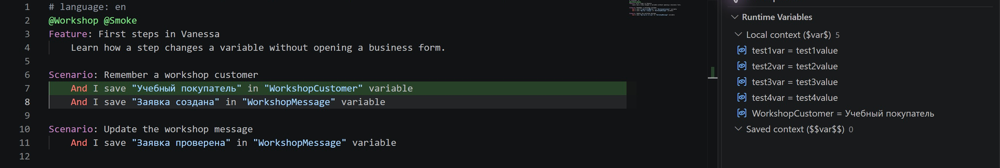
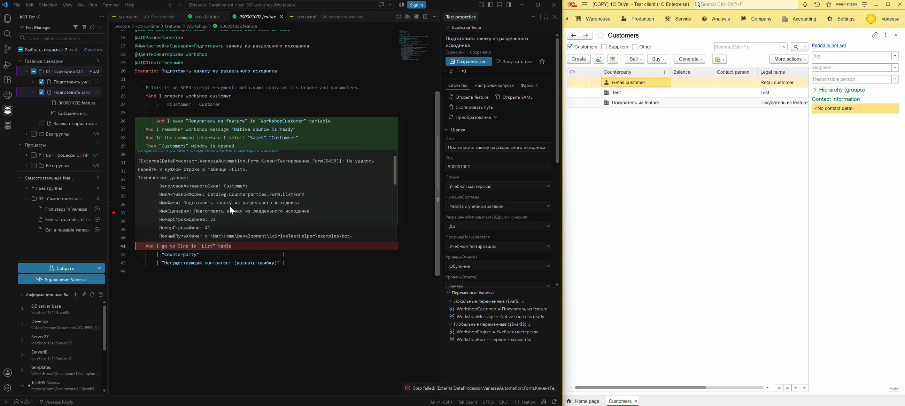
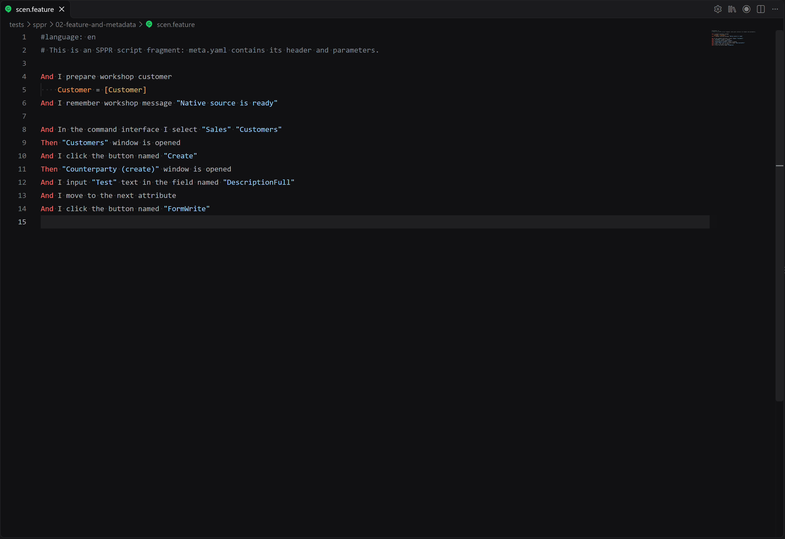

# Управление Vanessa из VS Code

KOT обращается к MCP Vanessa напрямую: для кнопок выполнения не нужна отдельная LLM. Управляемый менеджер остаётся открытым между действиями, а тестовые клиенты выбираются отдельно.

*Учебный пример в Windows: зелёная строка — подтверждённый шаг, справа — значение из работающей Vanessa.*

## Подключить сеанс

Нажмите **Подключить Vanessa** в Менеджере тестов. KOT может запустить собственный подготовленный менеджер или подключиться к совместимому работающему сеансу. Локальные соединения обнаруживаются автоматически там, где это возможно; адрес можно задать в настройках подключения.

Состояние **Ready** внизу означает доступность менеджера, но не гарантирует подключённый тестовый клиент. Откройте **Информационные базы**, выберите клиента и подключите его.

## Выполнение

| Действие | Как использовать |
|---|---|
| Полный запуск | Run в Менеджере тестов, свойствах или редакторе |
| Один шаг | Каретка на исполняемом шаге сохранённой feature → **F11** |
| Запуск с шага | Контекстное меню KOT → запуск с выбранной строки |
| Выделенные шаги | Выделите обычные шаги вместе с относящимися к ним таблицами/текстом → выполнить выделение |
| Точка останова | Поле слева от строки либо команда KOT |
| Остановить / продолжить | Управление сеансом; продолжение после подтверждённой точки |

Перед действием KOT сверяет сохранённую feature с копией в Vanessa. Безопасно устаревшая копия может быть перезагружена; чужой несохранённый текст не заменяется. Открытие вкладки само по себе не должно сбрасывать текущий прогон.

При F11 KOT сохраняет подтверждённые точки текущей feature и восстанавливает их, если Vanessa сбросила их при загрузке шага. Это относится и к точкам, поставленным в самой Vanessa. Если восстановление не подтверждено, устаревшие маркеры в VS Code убираются и появляется сообщение об ошибке.

Для шага в YAML доступны **проба без сборки** и отдельное выполнение **по карте сборки**. Проба рассчитана на однозначный обычный шаг Vanessa с поддерживаемыми аргументами; сложные конструкции СППР и вложенные вызовы требуют компиляции. Результат отмечается у исходной строки. Скорость зависит также от загрузки feature, каталога и синхронных запросов Vanessa.

### Пример: точка останова и ошибка

[Смотреть видео · 42 с, без звука](../assets/breakpoint-and-error.mp4). Слева — KOT, справа — клиент 1С. Прогон останавливается перед точкой, затем отдельные шаги выполняются дальше. В конце проверка намеренно несуществующей строки таблицы завершается ошибкой: её текст и технические данные видны при наведении в редакторе.
Если Vanessa подтверждает переключение точки, но её список MCP остаётся прежним, KOT сообщает об этом отдельно и не показывает неподтверждённую точку как установленную. Проверьте её в редакторе Vanessa перед повторной попыткой: повтор команды переключения может снять уже появившуюся точку. Такое расхождение воспроизведено в одном сеансе `.45`; [подробности и черновик issue](../superpowers/issues/2026-10-21-vanessa-mcp/14-breakpoint-confirmation.md).

## Записать действия

1. Откройте целевой YAML/feature и поставьте каретку в место вставки.
2. Выберите **Начать запись действий**.
3. Выполните действия в тестовом клиенте.
4. В KOT нажмите **Остановить запись и вставить шаги**.

Полученный текст вставляется с согласованными отступами и одним Undo. Повторная запись не требует возвращаться к промежуточной вкладке. Язык определяется настройкой генератора Gherkin в работающей Vanessa; настройка языка новых файлов сама по себе не переводит записанные шаги.

Если остановить запись **в самой Vanessa**, в `.45` KOT может увидеть смену состояния, но безопасного отдельного чтения готового текста нет. Текст может остаться в Vanessa; автоматическая вставка такого результата не обещается.

### Пример: запись в парный scen.feature

[Смотреть видео · 21 с, без звука](../assets/recording-flow.mp4). Показаны начало записи, остановка кнопкой редактора и вставка готовых шагов у каретки. Сам клиент находится за пределами кадра. На стоп-кадре выше можно спокойно прочитать результат: открытие списка, создание элемента, ввод текста и запись.

## Переменные, ошибки и диагностика

Раскройте **Переменные Vanessa** справа. Группы **Локальные переменные** (`$Имя$`) и **Глобальные переменные** (`$$Имя$$`) показывают текущие значения подключённого сеанса. Локальные очищаются перед началом сценария, глобальные сохраняются между сценариями, пока работает Vanessa. Доступны автообновление, строковое изменение карандашом и удаление локальных переменных. Чтение типов и удаление глобальных переменных ограничены проверенным API. Начальные глобальные значения для следующего запуска задаются отдельно в [параметрах сборки и запуска](parameters-manager.md).

Цвет строки показывает подтверждённый результат; hover на ошибке — полученную причину. MCP дополняется чтением фактического журнала сеанса. Если истории недостаточно или сопоставление неоднозначно, KOT не должен считать непроверенную строку успешной.

В диагностике доступны состояние, клиенты, результаты, явное чтение журналов, снимки и локальный ZIP. Диагностический сбор журналов запускается явно; экспорт не отправляется автоматически. Из текста удаляются стандартные секреты; содержимое снимка экрана не редактируется.

**Поиск шагов работающего сеанса** и **проверка синтаксиса feature** дополняют локальные подсказки. Проверка синтаксиса может открыть/перезагрузить файл в Vanessa, но не выполняет его шаги.

[Form Explorer](form-explorer.md) · [Клиенты](infobase-manager.md) · [Технические границы MCP](../technical/execution-and-mcp.md)

## Привязать внешний прогон по журналу

Если тест запущен вне KOT, откройте соответствующую feature и выберите **KOT → Логи и отслеживание запуска → Отслеживать прогон по логу**. Укажите фактический журнал нужного сеанса. Для другой попытки есть переключение отслеживаемого прогона; остановка отслеживания прекращает наблюдение, а не выполнение теста в 1С.

Можно начать и с открытого log-файла: **Отслеживать прогон по открытому log-файлу**. Проверяйте, что журнал и feature относятся к одному запуску. [Другие действия контекстного меню](../context-menus.md).
