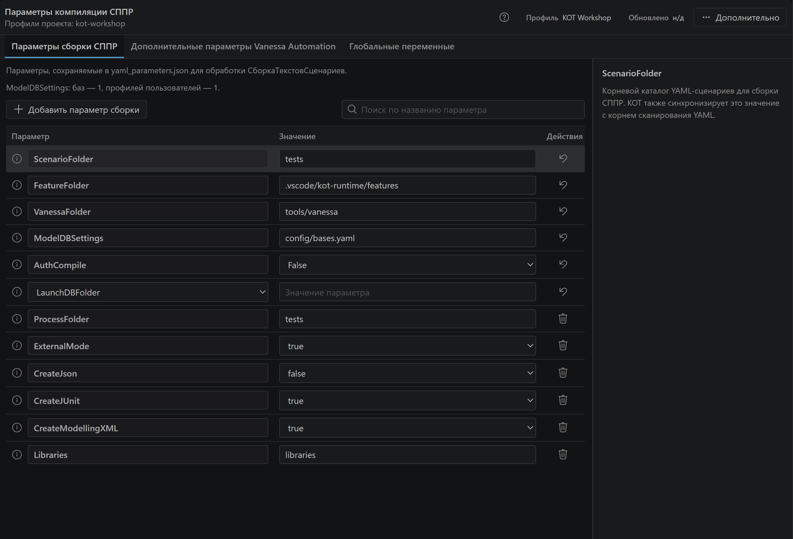

# Где что находится

## Рабочие области

| Область | Что здесь делать |
|---|---|
| KOT слева | Выбирать главные тесты, компилировать, запускать и раскрывать информационные базы |
| Отдельный значок Библиотеки | Искать шаги, сценарии и процессы, смотреть определения и вставлять вызовы |
| Редактор в центре | Писать исходник, переходить по F12, читать диагностику |
| Свойства справа | Менять шапку, параметры, настройки запуска, теги и вложения |
| Переменные справа | Смотреть значения подключённого сеанса Vanessa |
| Строка состояния снизу | Проверять подключение и открывать управление Vanessa |
| Полные панели в центре | Подробно работать с библиотекой, параметрами, базами и Form Explorer |

Свойства следуют за открытым тестом. Булавка закрепляет их; после её включения переход на другой файл не меняет выбранный объект.

## Как открыть инструмент

Начните с меню KOT или палитры команд VS Code. Поиск по названию, например «библиотека», «платформы» или «настроить проект», находит соответствующую команду. Английские подписи зависят от языка интерфейса.

В редакторе контекстные действия находятся в подменю **KOT**. F12 — обычный переход к определению, F11 — выполнение шага через Vanessa в поддерживаемом контексте.

Кнопки над текстом необязательны: они включаются отдельно для YAML и feature. Их отсутствие не отключает свойства, контекстное меню и команды.

## Полные панели инструментов

Раскройте нужный обзор. Под снимком указано, за что отвечает каждая область; подробные действия описаны в связанном руководстве.

### Библиотека

Поиск, список определений и подробности выбранного сценария

| Где | Что находится |
|---|---|
| Вверху | Поиск, язык определений, сортировка, создание и обновление |
| Слева | Источники и категории: шаги Vanessa, экспортные и вложенные сценарии, процессы |
| В центре | Найденные определения; выбор строки открывает её подробности |
| Справа | Источник, описание, параметры, шаблон вызова и файлы выбранного определения |
| Справа внизу | Вставка в открытый сценарий, копирование, переход к исходнику и доступные преобразования |

Боковая Библиотека удобна рядом с текстом; полная панель позволяет одновременно видеть каталог, результаты и подробности. [Поиск и вставка шагов](guides/editor-and-intellisense.md).

### Исследователь формы

Текущая форма, дерево элементов и шаги Vanessa

| Где | Что находится |
|---|---|
| В верхней строке | Источник данных, окна клиента, клиенты тестирования и инструменты MCP |
| Слева вверху | Текущая форма, обновление и проверки всей формы |
| Слева ниже | Поиск и дерево групп и элементов; стрелка раскрывает вложенность |
| Справа вверху | Подпись, техническое имя, значение и состояние выбранного элемента |
| Справа ниже | Детали элемента и текст шагов Vanessa со свободным выделением |

[Получить шаги с живой формы](guides/form-explorer.md).

### Информационные базы

Операции выбранной базы и её клиенты тестирования

Слева выбирают базу, справа работают с ней и её клиентами. В боковой версии клиенты раскрываются под строкой базы.

| Где | Что находится |
|---|---|
| Слева | Поиск, сортировка, добавление и список информационных баз |
| Справа вверху | Имя и путь выбранной базы, состояние и выбор платформы |
| Справа в центре | Запуск, операции с DT и CF, конфигурацией, папкой и журналами |
| Под операциями | Сведения о последнем запуске и ключах |
| В блоке клиентов | Отдельные профили пользователей и кнопка подключения каждого клиента |
| Внизу | Раскрываемые технические подробности записи базы |

Кнопка запуска базы и кнопка подключения клиента Vanessa относятся к разным объектам. [Базы и клиенты тестирования](guides/infobase-manager.md).

### Параметры сборки и запуска

Профиль проекта, три вкладки параметров и пояснения полей

| Где | Что находится |
|---|---|
| Вверху | Проект и активный профиль, дополнительные действия |
| Во вкладках | Параметры компилятора СППР, настройки самой Vanessa (`VAParams.json`) и начальные глобальные переменные |
| В центре | Таблица значений, поиск и добавление параметров |
| Справа | Пояснение выбранного параметра |

Параметры этого профиля относятся к компиляции и запуску. Свойства отдельного сценария и текущие значения переменных Vanessa открываются в других панелях. [Профили и приоритеты параметров](guides/parameters-manager.md).

## Не спутать два менеджера

**Менеджер тестов KOT** — интерфейс выбора и организации в VS Code. **Менеджер тестирования Vanessa** — отдельный сеанс 1С; он открывает клиентов тестирования проверяемых баз. Кнопка подключения KOT связывает эти части, но не заменяет выбор нужного клиента.

[Быстрый старт](QUICK_START.md) · [Реальные экраны](screenshots.md) · [Команды](technical/commands-reference.md)

Действия правой кнопки мыши разобраны в [карте контекстных меню](context-menus.md), а работа панелей на конкретных задачах — в [визуальном маршруте](visual-tour.md).
