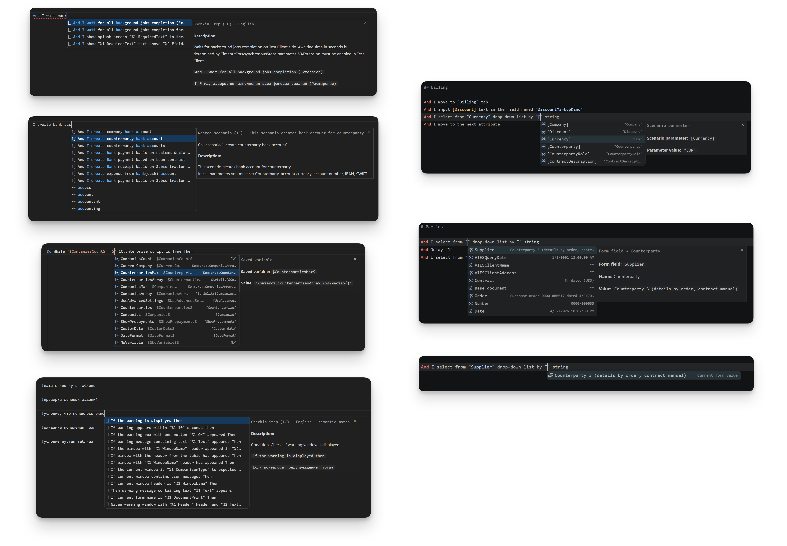
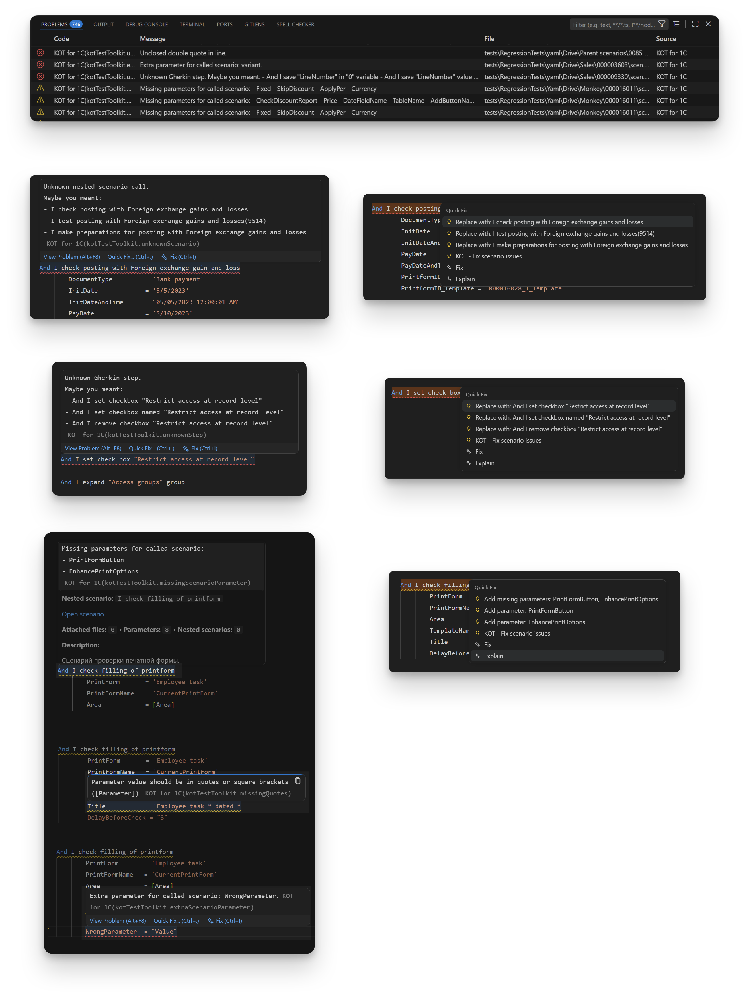
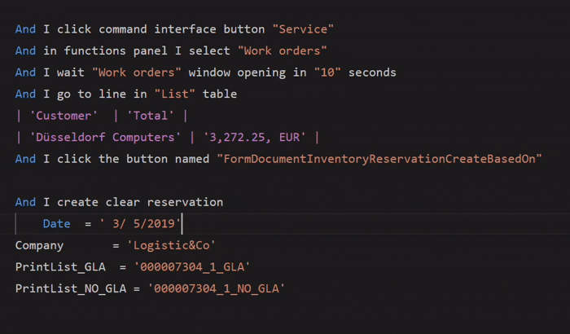
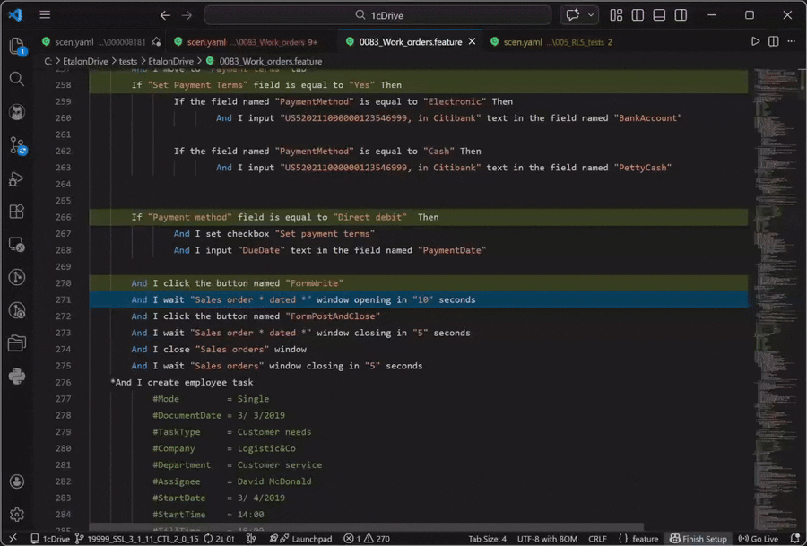
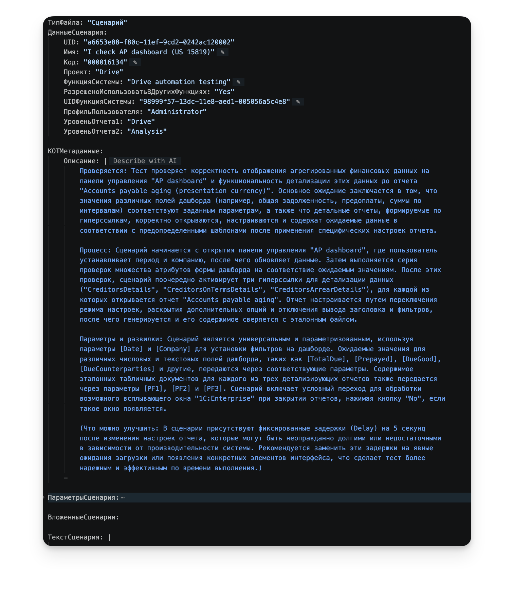

# Экраны и схемы KOT

В [визуальном маршруте](visual-tour.md) снимки сопровождаются действиями и ожидаемым результатом. Здесь — указатель отдельных кадров и их происхождение.

## Реальный интерфейс

Материалы показывают KOT 3.0.0 в Windows и macOS. В примерах используются учебная мастерская и прикладные формы 1С; подписи и тема зависят от настроек интерфейса. Карта рабочей области помогает найти панели, а отдельные кадры показывают их содержимое крупнее.

| Снимок | Что видно | На что обратить внимание |
|---|---|---|
| [Рабочая область](assets/workspace.png) | Менеджер тестов, текст feature и свойства | Текст и свойства редактируют один тест |
| [Первый запуск](assets/project-setup.png) | Четыре маршрута и копия мастерской | Для знакомства выполнение 1С не обязательно |
| [Создание теста](assets/create-scenario.png) | Выбор главного/вложенного сценария или процесса, feature, экспорта и пользовательского шага | Это выбор типа; дальнейшие поля мастер запрашивает отдельно |
| [Отчёт о сборке](assets/build-results.png) | Один успешный результат и ошибка второго теста со ссылкой `scen.feature:8` | Ошибка компиляции отделена от результата выполнения |
| [Менеджер тестов](assets/test-manager.png) | Группы главных сценариев и процессов | Отметки относятся к набору компиляции |
| [Боковая Библиотека](assets/library.png) | Экспорты, вложенные и главные сценарии, процессы, feature | Каталог определений шире списка самостоятельных тестов |
| [Полная Библиотека](assets/library-full.png) | Поиск `workshop`, источники слева, результаты в центре и подробности справа | Параметры, вставка, копирование, преобразования и переход к исходнику доступны рядом с определением |
| [Поиск через !](assets/semantic-search.png) | Результаты запроса `!условие таблица` | Запрос заменяется вызовом, а не сохраняется как шаг |
| [Меню KOT](assets/editor-context-menu.png) | Актуальное подменю на шаге парного `scen.feature` в Windows | Команды выполнения и разделы точек останова, записи, журналов и создания |
| [Параметры](assets/scenario-parameters.png) | Объявление Customer в `meta.yaml`, использование в `scen.feature` и поля в свойствах | Раздельный текст и свойства относятся к одному параметру |
| [Подсказки переменных](assets/editor-variables.png) | Локальная переменная из предыдущего шага и GlobalVars профиля | Подсказка в тексте и фактическое значение работающего сеанса — разные источники |
| [Преобразования](assets/conversions.png) | Выпадающее меню вложенного сценария | Доступны переход в главный тест, изменение формата и преобразование в экспортный |
| [Аргумент feature](assets/feature-form-completion.png) | Подписи полей формы и техническое имя выбранного поля | Аргумент шага заполняется данными формы |
| [Аргумент feature + meta](assets/native-form-completion.png) | Технические имена кнопок в фрагменте СППР | Заголовок Scenario не требуется |
| [Form Explorer](assets/form-explorer.png) | Дерево формы SpaceCash и шаги для поля Description | Можно выделить только нужную часть текста |
| [Выполнение шага](assets/step-execution.png) | Зелёная строка и WorkshopCustomer | Подтверждён один шаг; остальные ещё не выполнялись |
| [Полный менеджер баз](assets/infobase-manager-full.png) | Список баз слева, подробности TestIB5 и подключённый клиент справа | Выбор базы и управление её клиентами находятся в одной панели |
| [Клиенты одной базы](assets/test-client-profiles.png) | Подключённый клиент и отдельный пользователь со статусом Только в Vanessa | Дискета в действиях строки сохраняет профиль в KOT |
| [Добавление клиента](assets/test-client-create.png) | Форма новой записи с именем, пользователем, паролем и раскрытыми параметрами подключения | Сохранение профиля и подключение клиента — отдельные действия |
| [Профили проекта](assets/project-profiles.png) | Текущий KOT Workshop и действия над профилями | Импорт прежнего общего профиля создаёт копию в текущем проекте |
| [Настройки](assets/settings.png) | Закреплённая навигация и прокрученная правая область | Значения продолжают храниться в настройках VS Code |
| [Менеджер параметров](assets/parameters-manager.png) | Три вкладки, корни, launch-база и `CreateJson=false` | Пустая launch-база допустима именно при таком режиме |
| [Диагностика и Quick Fix](assets/diagnostics-quick-fix.png) | Опечатка, Problems, `Maybe you meant` и `Replace with` | Правильный вариант исправления выбран и проверен в учебной копии |

Материалы показывают учебную мастерскую и подготовленные формы 1С. Данные формы получены от Vanessa по MCP. Имена баз, версии каталогов и значения относятся к снятому сеансу; обновлённые кадры могут отличаться от предыдущих подписью кнопок или языком интерфейса.

## Видео

### Запись действий в парный scen.feature

https://github.com/user-attachments/assets/61768005-3fce-489f-b8a4-dc3395221d72

Начало записи, остановка из KOT и вставка шагов у каретки. Видео показывает редактор; действия в клиенте остаются за кадром. [Неподвижный кадр результата и пояснения](guides/vanessa-control.md#пример-запись-в-парный-scenfeature).

### Точка останова, выполнение и ошибка

https://github.com/user-attachments/assets/eaa3e411-c519-40f0-ac45-1028396db667

Запуск с выбранной строки, остановка перед точкой, дальнейшее выполнение и сообщение об ошибке при наведении. [Кадр результата и пошаговые пояснения](guides/vanessa-control.md#пример-точка-останова-и-ошибка) помогают изучить детали без воспроизведения видео.

## Подсказки, исправления и выполнение в редакторе

### Автодополнение

Коллаж объединяет примеры из разных контекстов: начало шага, параметр СППР, переменная и аргумент, связанный с формой. [Как пользоваться подсказками](guides/editor-and-intellisense.md).

### Диагностика и Quick Fix

Неизвестные определения, пропущенные параметры, лишние присваивания и кавычки видны прямо в тексте. Quick Fix предлагает подходящие исправления. [Сообщения и действия](guides/diagnostics-and-quick-fix.md).

### Выравнивание при сохранении

Настройка выравнивания и упражнение описаны в [редакторе](guides/editor-and-intellisense.md) и [мастерской](../examples/kot-workshop/guide/02-editor.md).

### Отслеживание прогона по журналу

Показано наблюдение по журналу: текущая строка, выполненные шаги и причина ошибки при наведении. [Подключение журнала](guides/vanessa-control.md#привязать-внешний-прогон-по-журналу) · [Диагностика выполнения](guides/diagnostics-and-quick-fix.md#во-время-выполнения).

## Архивные экраны

### AI-описание

В 3.0.0 описание доступно в свойствах и хранится по текущим правилам метаданных. [Как получить и проверить такой результат](guides/ai-description.md).

Полный [архив иллюстраций README 2.7.1](https://github.com/alexiosus/KOTfor1C/blob/1f6db371b2f197d450b1593f38785b4b79c2d5f1/README.md#скриншоты) содержит также hover, избранное, контекстное меню и прежние менеджеры. Для повседневной работы используйте современные кадры выше.

## Схемы

[Визуальный маршрут](visual-tour.md) · [Области полных панелей](interface.md#полные-панели-инструментов) · [План новых кадров с местами вставки](screenshot-plan.md) · [Все руководства](README.md)
