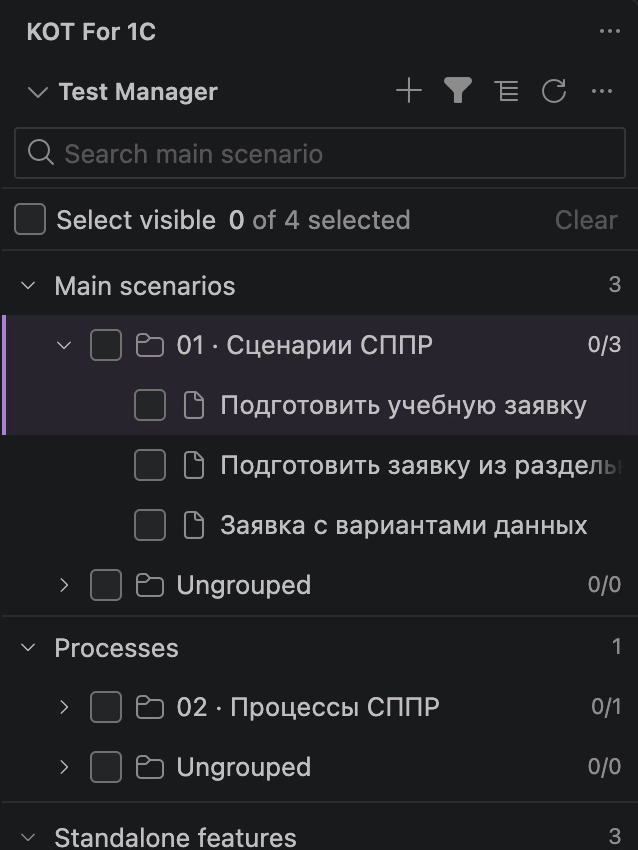
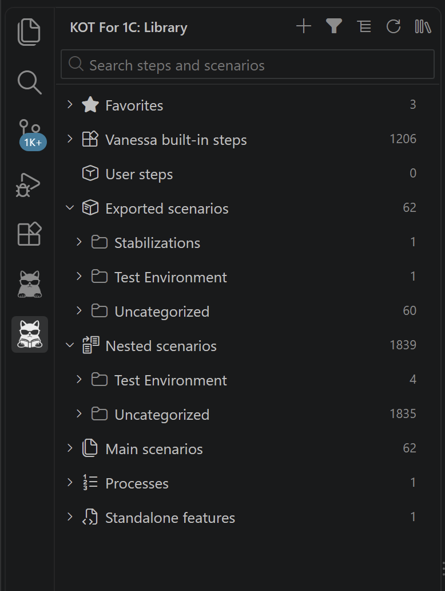
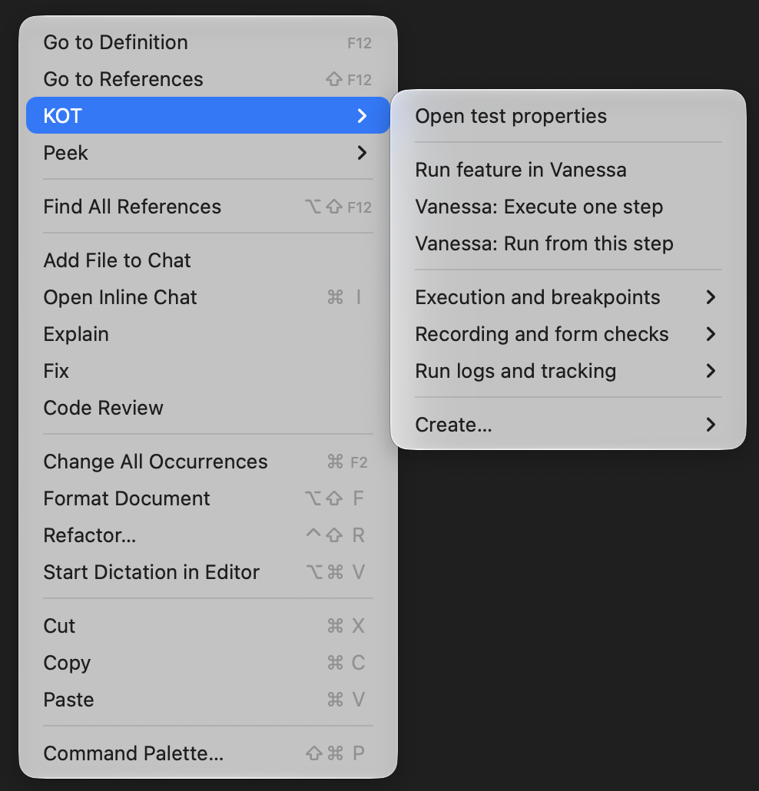
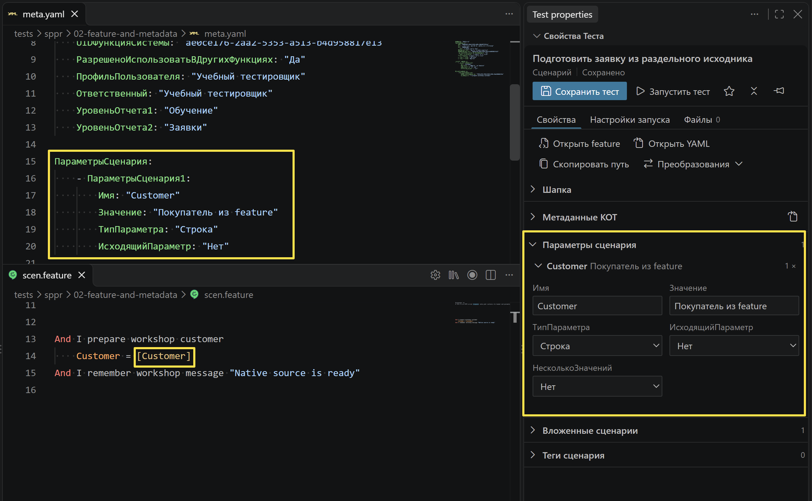
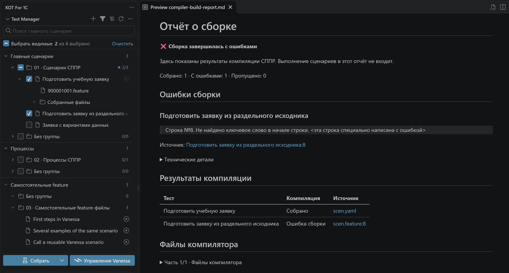
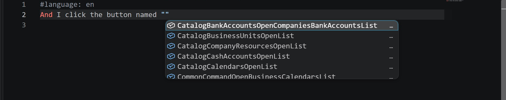
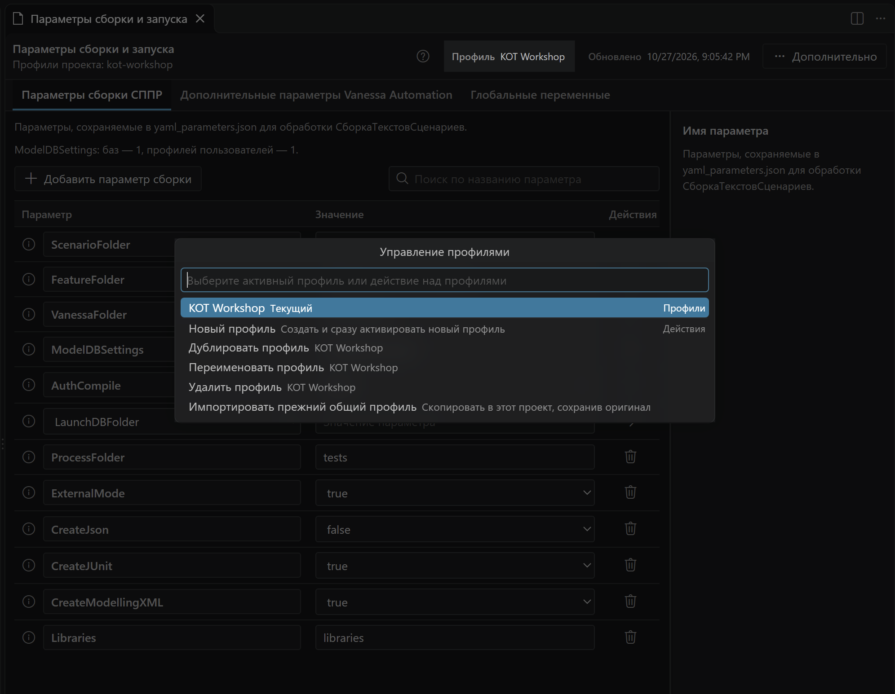
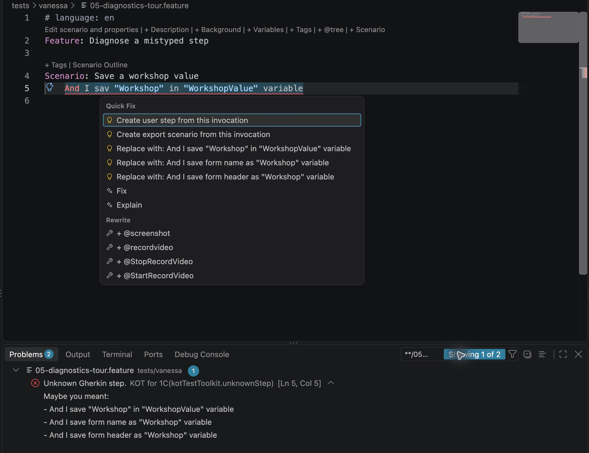
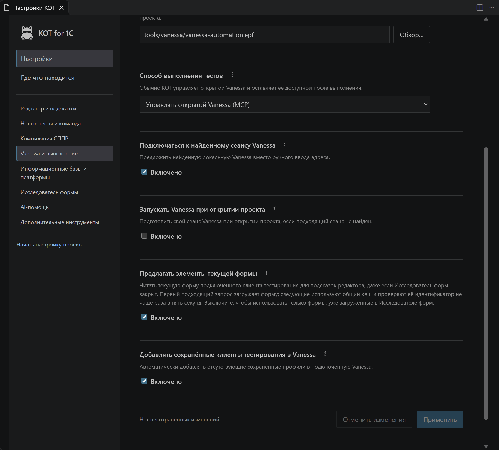

# KOT в действии: визуальный маршрут

Этот маршрут показывает не только расположение панелей, но и конкретные действия. Все экраны — реальный интерфейс KOT. Для редактора и свойств использована копия мастерской; формы и подсказки аргументов получены от Windows-сеанса Vanessa. Схемы и происхождение снимков собраны в [галерее](screenshots.md).

## 1. Выбрать способ начала работы

1. Выберите новый проект, существующий СППР, Vanessa или переход со старого KOT.
2. Проверьте найденные каталоги и выберите, нужно ли подключать выполнение сейчас.
3. Перед применением прочитайте план. Для знакомства достаточно копии мастерской.

**Что вы получаете:** подходящую настройку проекта без необходимости сразу устанавливать всё окружение 1С. [Мастер и настройки](guides/first-run-settings.md).

### Создать свой тест

Нажмите **+** в Менеджере тестов и выберите главный или вложенный сценарий/процесс, самостоятельную feature либо экспортный сценарий. [Меню создания и дальнейшие шаги мастера](guides/scenario-creation.md#создать-сценарий-сппр).

## 2. Выбрать тест или найти определение

Галочки выбирают набор для компиляции. Главные процессы и самостоятельные feature имеют отдельные секции. Фильтры помогают оставить собранные, выполняемые или связанные тесты.

Библиотека решает другую задачу: найти определение, увидеть его параметры и вставить вызов. Поэтому здесь видны также вложенные объекты, не являющиеся самостоятельными тестами.

Для подробной работы откройте [полную Библиотеку](interface.md#библиотека): источники, найденные определения и сведения выбранного сценария расположены в трёх областях.

**Следующий шаг:** [организация набора](guides/test-manager.md) или [поиск и вставка](guides/editor-and-intellisense.md).

## 3. Найти шаг по смыслу через `!`

1. На новой строке введите `!условие таблица`; точное начало имени не требуется.
2. Прочитайте варианты и их описание. Первый результат не обязан подходить вашей задаче.
3. Выберите нужный: вместо запроса вставится настоящий шаг с аргументами.

**Что важно:** поиск локальный, учитывает язык и доступный каталог. Он не обращается к AI и не создаёт неизвестный Vanessa шаг. [Поиск в тексте](guides/editor-and-intellisense.md#поиск-по-смыслу-через-).

## 4. Найти действие рядом с текстом

Правый клик → **KOT**. Частые команды запуска доступны сразу; ниже — выполнение и точки останова, запись/проверки формы, журналы и создание. В YAML СППР состав меню дополнен действиями его структуры.

**Что попробовать:** открыть свойства, найти вызовы, выполнить выделение или привязать внешний журнал. Набор пунктов зависит от места каретки. [Карта всех контекстных меню](context-menus.md).

## 5. Изменить параметр и увидеть его использование

Слева сверху `meta.yaml` хранит объявление параметра, снизу `scen.feature` использует `[Customer]`. Справа тот же параметр редактируется через свойства теста. Счётчик показывает использование в тексте.

1. Раскройте параметр и измените значение по умолчанию.
2. Сохраните тест. Для парного формата сохраняются и текст, и метаданные.
3. При необходимости переопределите значение в настройке запуска, не меняя общий сценарий.

**Продолжение:** [параметры и переменные](guides/scenario-parameters.md), [передача через процесс](guides/compiler-process-parameters.md).

## 6. Изменить формат или роль теста

Кнопка **Преобразования** показывает подходящие действия. На кадре открыт вложенный сценарий: его можно сделать главным, изменить формат или преобразовать в совместимый экспортный сценарий.

Выбирайте между изменением хранения YAML ↔ feature + meta и изменением назначения главный ↔ вложенный. Это разные операции. Для вложенный ↔ экспортный проверяются параметры и поддерживаемые вызовы. [Условия и результат преобразований](guides/scenario-source-formats.md).

## 7. Собрать тест и разобраться с результатом

Отметьте нужные главные тесты и нажмите **Собрать**. На примере первый тест собран, а второй содержит ошибку. Ссылка `scen.feature:8` открывает строку исходника; файлы и подробности компилятора раскрываются ниже. Слева у успешного теста доступны feature и **Собранные файлы**.

Здесь проверяется компиляция СППР. Выполнение шагов в клиенте 1С — следующий этап. [Профиль, сборка и запуск](guides/build-and-vanessa-run.md#разобрать-результат-компиляции).

## 8. Получить аргумент с текущей формы

Поставьте каретку между кавычками или заменяйте выделенное имя аргумента из шаблона. В шаге ввода текста предлагаются поля текущей формы: рядом с подписью можно посмотреть техническое имя.

В шаге `button named` нужны технические имена кнопок.

**Если списка нет:** проверьте клиента, текущую форму и настройку **Предлагать элементы текущей формы** (`kotTestToolkit.vanessaControl.formCompletions`). `Ctrl+Space` вызывает подсказки вручную. Для аргумента времени ожидания или произвольного текста список элементов не предназначен. [Подсказки аргументов](guides/editor-and-intellisense.md#подсказки-аргументов-формы).

## 9. Исследовать форму и взять часть готовых шагов

Найдите элемент по дереву или поиском. Справа показаны его свойства и нативные шаги; текст можно выделять частями. Стрелка раскрывает группу отдельно от выбора строки. Кнопка **Вставить проверки всей формы** находится в блоке **Текущая форма**.

**Различайте:** подсказки выбранного элемента, проверки всей формы и штатную проверку текущего элемента Vanessa — это разные операции с разными границами MCP. [Form Explorer](guides/form-explorer.md).

## 10. Проверить шаг и посмотреть значение

На кадре выполнен один учебный шаг: он отмечен зелёным, а справа появилось фактическое значение `WorkshopCustomer`. Остальные строки ещё не выполнялись.

Для одного шага используйте F11; для нескольких — запуск выделенных строк или запуск сценария с шага. Точки останова задаются у строки. Ошибка показывается при наведении на упавший шаг.

https://github.com/user-attachments/assets/eaa3e411-c519-40f0-ac45-1028396db667

**Точка останова, выполнение и ошибка** После остановки на точке выполняются следующие шаги, затем намеренно ошибочная проверка строки таблицы показывает причину сбоя. [Подробности и команды](guides/vanessa-control.md#пример-точка-останова-и-ошибка).

### Записать действия вместо ручного ввода

Начните запись из KOT, выполните действия в клиенте и остановите её из редактора. Полученные шаги вставятся у каретки.

https://github.com/user-attachments/assets/61768005-3fce-489f-b8a4-dc3395221d72

**Запись действий** Ролик и [готовый текст крупным планом](guides/vanessa-control.md#пример-запись-в-парный-scenfeature) показывают результат в `scen.feature` рядом с `meta.yaml`.

## 11. Управлять базой и клиентом тестирования

Сначала выберите базу, затем нужную задачу: обычный запуск 1С, открытие через Vanessa, работа с DT или конфигурацией. Дополнительные операции находятся в меню **…** соответствующей строки.

В блоке **Клиенты тестирования Vanessa** видны профили и фактическое подключение. На кадре TestClient_TestIB5 уже подключён; кнопка **Отключить** относится именно к нему. Второй пользователь доступен **Только в Vanessa**: дискета сохраняет его профиль в KOT. **Готова** у базы означает её доступность для KOT, а не успешное прохождение теста.

[Базы, профили и операции DT/CF](guides/infobase-manager.md).

## Профиль и исправление опечатки крупным планом

Нажмите имя текущего профиля в шапке менеджера. Отсюда можно создать или дублировать профиль, а после обновления — импортировать прежний общий профиль в текущий проект. В учебном KOT Workshop заданы `CreateJson=false` и пустая launch-база: для полного запуска потребуется своё окружение. [Профили проекта](guides/parameters-manager.md#профили-принадлежат-проекту) · [Обязательные поля для JSON](guides/parameters-manager.md#минимальная-проверка-сппр).

Вместо ручного поиска по всей библиотеке откройте Quick Fix и выберите корректное `Replace with`. После применения проверьте оставшиеся Problems. [Таблица сообщений и действий](guides/diagnostics-and-quick-fix.md#частые-сообщения-и-действия).

## 12. Настроить расширение и перейти к следующим инструментам

Страница настроек объединяет разделы и поиск; техническое имя и источник значения доступны рядом с настройкой. Есть переход в нативные настройки VS Code. Настройка проекта запускается отдельно.

Другие рабочие маршруты:

| Задача | Что открыть |
|---|---|
| Сравнить исходный и итоговый JSON, выбрать профиль | [Параметры сборки и запуска](guides/parameters-manager.md) |
| Подключить клиента, сохранить Vanessa-only профиль, восстановить DT | [Информационные базы](guides/infobase-manager.md) |
| Добавить свои шаги и собрать библиотеку | [Создание и переиспользование](guides/scenario-creation.md) |
| Проверить весь проект или заполнить служебные секции | [Менее заметные действия](everyday-workflows.md) |
| Подключить внешнее выполнение по журналу | [Наблюдение за прогоном](guides/vanessa-control.md#привязать-внешний-прогон-по-журналу) |
| Описать сценарий или проверить изменения с помощью AI | [AI-инструменты](guides/ai-description.md) |

[Начать с первого упражнения](QUICK_START.md) · [Полная карта возможностей](capabilities.md) · [Все руководства](README.md)
