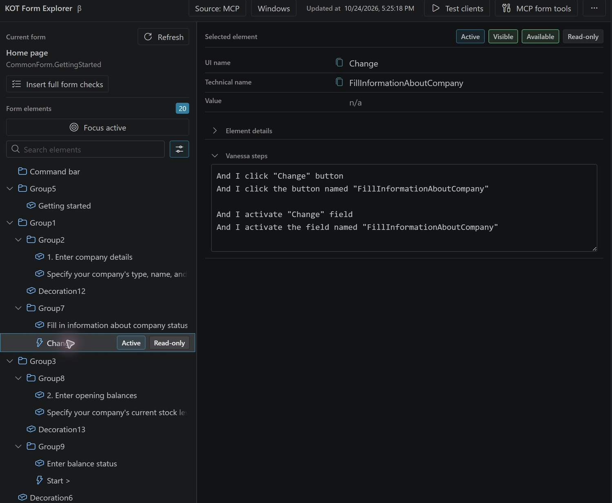

# Form Explorer: от формы к шагам

Form Explorer показывает интерфейс текущего клиента тестирования: группы, элементы, колонки и доступные значения. Он помогает выбрать правильное имя элемента и получить шаги для сценария.

*Реальная форма тестового клиента в Windows: источник MCP, группы слева, свойства и шаги Vanessa справа.*

## Начать работу

1. Подключите Vanessa и нужный клиент тестирования.
2. Откройте **Form Explorer** из KOT или через действие выбранной базы.
3. При необходимости выберите внутреннее окно клиента.
4. Найдите элемент в дереве или поиском.
5. Выделите нужную часть полученного текста и скопируйте либо вставьте её в сценарий.

KOT поддерживает MCP-источник и прежний мост Form Explorer. Их возможности различаются. Данные активной формы могут использоваться в IntelliSense; при наличии файловой выгрузки конфигурации добавляются доступные статические сведения.

## Дерево и детали

Структура отражает группы и вложенность, в том числе колонки таблиц. Стрелка раскрывает группу отдельно от выбора строки. Детали выбранного элемента показывают то, что вернул источник: имя, техническое имя, состояние, значение и другие доступные поля.

Неверное значение отдельного элемента или ошибка генерации шагов не должны очищать отдельно подтверждённое дерево. При смене клиента/окна прежние данные сбрасываются, чтобы не предлагать элементы чужой формы. После изменения структуры той же формы используйте **Обновить**.

## Vanessa steps

В режиме MCP нативные подсказки запрашиваются автоматически. Выбор подходящего элемента переводит на него фокус в тестовом клиенте: проверенная Vanessa `.45` формирует подсказки для **активного** элемента.

Текст показан полем со свободным выделением. Не обязательно копировать весь вывод. При быстром переключении KOT публикует результат только актуального выбора; повторный выбор использует кеш с проверкой актуальности. Сворачивание блока не запускает новый анализ.

Группа, скрытый или неоднозначный элемент не всегда может быть активирован. Эти подсказки отличаются от штатной команды Vanessa «Получить проверку текущего элемента формы в виде шагов»: отдельного подтверждённого MCP-эквивалента этой команды в `.45` нет.

## Проверки формы и инструменты

**Insert full form checks** находится в блоке **Current form**. Полные проверки используют нижнюю область вывода и явную вставку; язык зависит от работающей Vanessa и доступного инструмента.

**MCP form tools** открывает типизированные поля инструментов, объявленных сеансом: поиск, действия с элементами и окнами, командный интерфейс, запись, выгрузка табличного документа и связанные чтения. Это универсальная форма вызова, а не отдельный специализированный редактор каждой операции.

Чтение данных БД не равно чтению всех строк UI-таблицы. Полная иерархия/значения, определение активного элемента и отмена длинных синхронных запросов ограничены upstream API. [Подробная матрица](../technical/execution-and-mcp.md).

[Подсказки редактора](editor-and-intellisense.md) · [Запись действий](vanessa-control.md)

## Если используется прежний мост

Для bridge-источника доступны ручное и автоматическое обновление snapshot. Технические атрибуты и команды могут быть скрыты за дополнительной информацией. Режим и возможности моста не следует переносить на MCP-источник; выберите подходящий источник в настройках. [Устройство источников](../technical/form-explorer-bridge.md).
