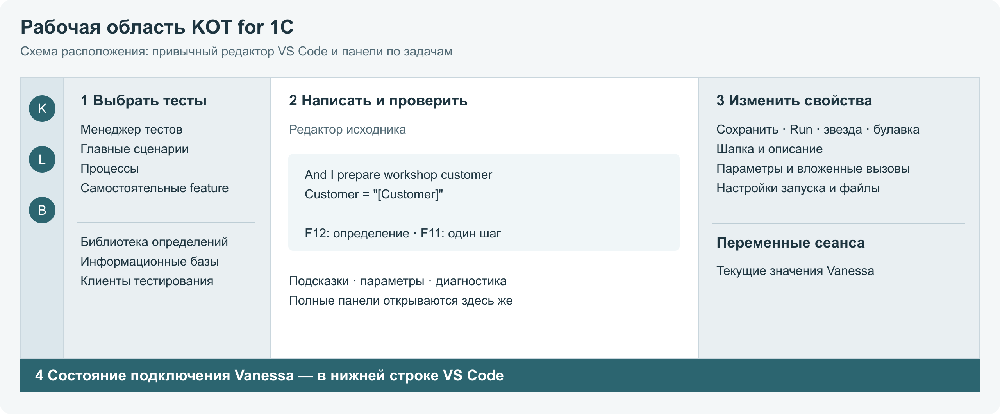

# Где что находится

## Рабочие области

| Область | Что здесь делать |
|---|---|
| KOT слева | Выбирать главные тесты, компилировать, запускать и раскрывать информационные базы |
| Отдельный значок Библиотеки | Искать шаги, сценарии и процессы, смотреть определения и вставлять вызовы |
| Редактор в центре | Писать исходник, переходить по F12, читать диагностику |
| Свойства справа | Менять шапку, параметры, настройки запуска, теги и вложения |
| Переменные справа | Смотреть значения подключённого сеанса Vanessa |
| Строка состояния снизу | Проверять подключение и открывать управление Vanessa |
| Полные панели в центре | Подробно работать с библиотекой, параметрами, базами и Form Explorer |

Свойства следуют за открытым тестом. Булавка закрепляет их; после её включения переход на другой файл не меняет выбранный объект.

## Как открыть инструмент

Начните с меню KOT или палитры команд VS Code. Поиск по названию, например «библиотека», «платформы» или «настроить проект», находит соответствующую команду. Английские подписи зависят от языка интерфейса.

В редакторе контекстные действия находятся в подменю **KOT**. F12 — обычный переход к определению, F11 — выполнение шага через Vanessa в поддерживаемом контексте.

Кнопки над текстом необязательны: они включаются отдельно для YAML и feature. Их отсутствие не отключает свойства, контекстное меню и команды.

## Не спутать два менеджера

**Менеджер тестов KOT** — интерфейс выбора и организации в VS Code. **Менеджер тестирования Vanessa** — отдельный сеанс 1С; он открывает клиентов тестирования проверяемых баз. Кнопка подключения KOT связывает эти части, но не заменяет выбор нужного клиента.

[Быстрый старт](QUICK_START.md) · [Реальные экраны](screenshots.md) · [Команды](technical/commands-reference.md)
