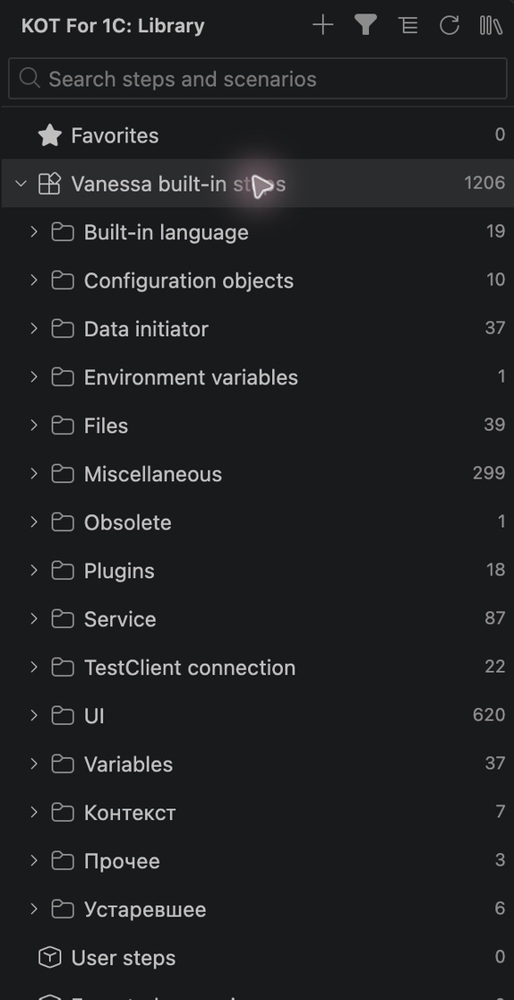
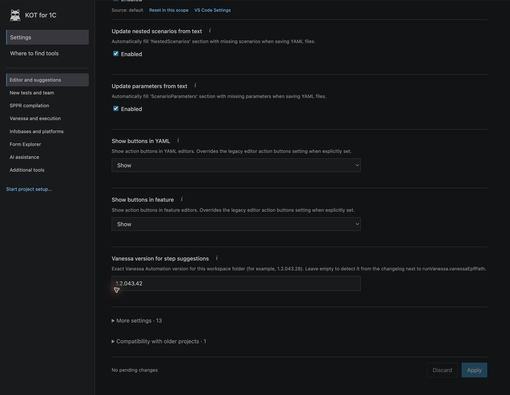

# Экраны и схемы KOT

Материалы относятся к KOT 3.0.0. Редактор и основные панели сняты в macOS Extension Development Host на отдельной копии учебного проекта. Выполнение шага и Form Explorer сняты в Windows через Parallels с подключённой Vanessa и клиентом тестовой базы. Подписи интерфейса на английском, учебные данные — на русском и английском.

## Редактор и свойства feature

Слева видны главные сценарии, процессы и самостоятельные feature. Справа — заголовок, теги, группа, JSON запуска, структурные блоки и список сценариев. Ни реальное подключение к 1С, ни прохождение шагов в этом кадре не имитировались.

## Менеджер тестов

Это отдельный фрагмент реального окна учебного проекта: видно отличие набора для компиляции от общего каталога определений. Строки и имена взяты из мастерской.

## Библиотека

Библиотека предназначена для поиска и вставки определений; она не является списком только запускаемых тестов.

## Страница настроек

Снимок показывает независимую прокрутку формы. Технические имена, источник и сброс доступны в самой странице; все значения продолжают храниться в настройках VS Code.

## Выполненный шаг и переменная

Windows-сеанс: выполнен первый шаг `01-first-steps.feature` из мастерской. Зелёный цвет относится к этому шагу; справа видно полученное значение `WorkshopCustomer = Учебный покупатель`. Остальные шаги в кадре ещё не выполнялись.

## Живая форма через MCP

Windows-сеанс: KOT получил структуру начальной страницы тестового клиента, перевёл фокус на элемент **Change** и показал шаги Vanessa по его подписи и техническому имени. Текст можно выделять частями. Выбор элемента здесь не нажимает саму кнопку в приложении.

## Как читать схемы

Эти две иллюстрации нарисованы специально для документации. Это **схемы**, а не изображения ещё не реализованного интерфейса. PNG-версии совместимы с Marketplace; редактируемые исходники доступны в SVG: [процесс](assets/test-workflow.svg), [рабочая область](assets/workspace-map.svg).

Снимки кадрированы и уменьшены для читаемости; содержимое элементов и состояния не дорисовывались. Из кадров исключены окружающие окна и личные пути. Исходные имена учебного проекта сохранены.

[Знакомство с интерфейсом](interface.md) · [Руководство](README.md)
